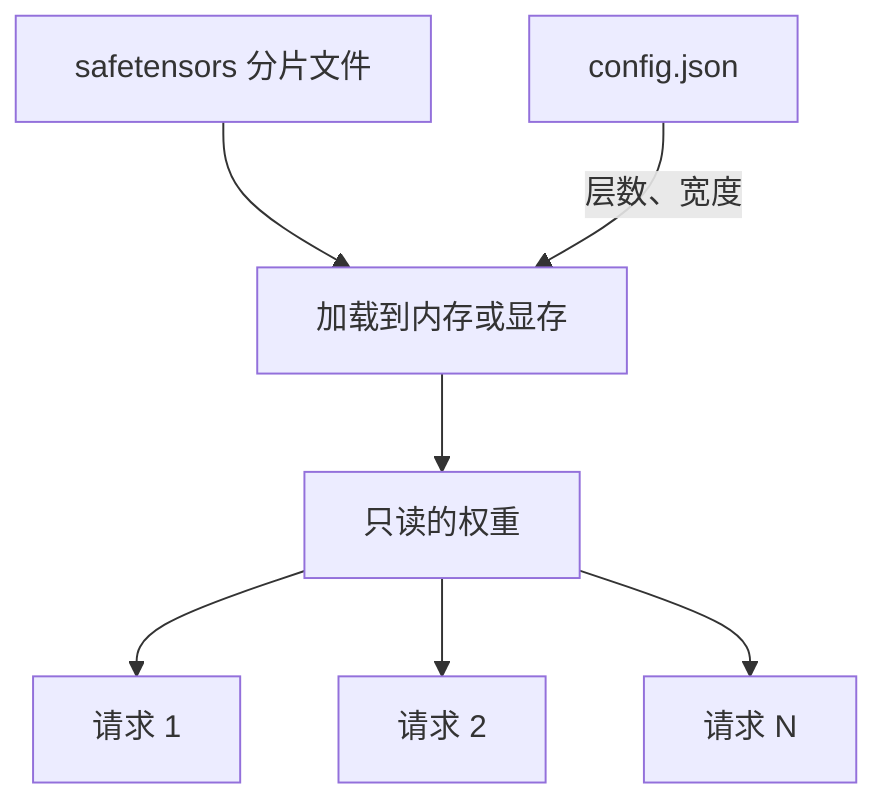

## Q
一个 70 亿参数（7B）的模型，参数存在哪里、占多大？推理时这些参数会变吗？

## A
参数就是一大堆浮点数，存在磁盘上的**权重文件**里，推理前整份加载到内存或显卡显存中。

- **每个参数占几个字节：** 训练好的大模型通常用 16 位浮点数保存（FP16 或 BF16，都是"半精度"格式），每个参数 2 字节。更早的 32 位浮点数（FP32）每个 4 字节。
- **算一下 7B：** 70 亿 × 2 字节 = 140 亿字节 ≈ **14 GB**。用 FP32 就是 28 GB。一台普通笔记本 16 GB 内存，装下 FP16 的 7B 模型都很勉强。
- **文件长什么样：** 常见格式是 Hugging Face 的 `model-00001-of-00002.safetensors` 这类分片文件，里面按名字存着一个个数组，例如 `model.layers.0.self_attn.q_proj.weight`，形状 `[4096, 4096]`。另有 `config.json` 描述结构（层数、宽度等）。

- **推理时只读不写：** 推理过程只拿参数做乘法和加法，从不修改它们。同一份权重可以同时服务成千上万个请求，就像一张只读的数据库表被很多查询共享。
- **超参数不是参数：** 层数、每层宽度、学习速度这类"人定的设置"叫超参数（hyperparameter），写在配置里，不是训练出来的。

工程含义：权重文件就是发布物（artifact）。它的大小决定加载要多久、要几张卡；文件和配置对不上（比如配置写 32 层、文件只有 30 层的权重），加载会报错，或者更糟，静默地算错。
