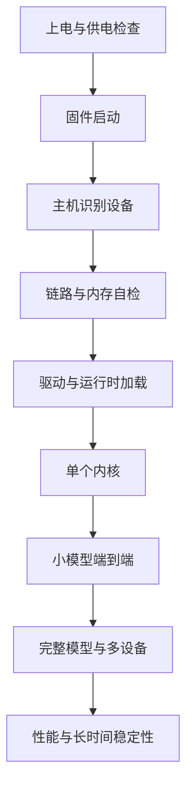

## Q
一款新硬件（或新一代系统）第一次拿到样品时，"上板"（bring-up）通常按什么顺序推进？每一步的通过标准是什么？

## A
**上板（bring-up）：** 把新硬件从"能通电"一步步推进到"能稳定运行完整工作负载"的过程。原则是从下往上，每一步只引入一个新变量，失败时容易定位。

**每一步与通过标准：**
1. **上电：** 电压、电流、温度在规格内，没有短路或过热。
2. **固件启动：** 设备上的固件正常启动，能报告版本和健康状态。
3. **主机识别：** 主机在总线上看到设备（如 `lspci` 能列出），链路以预期的速度和宽度建立。
4. **链路与内存自检：** 跑内存读写测试、链路误码率测试，没有错误。
5. **驱动与运行时：** 驱动加载、运行时初始化成功，能分配和释放设备内存，主机和设备之间能正确拷贝数据（写入随机数据再读回比较）。
6. **单个内核：** 一个已知答案的最小计算（比如向量加法、小矩阵乘法）结果正确。逐步扩大到常用算子的单元测试。
7. **小模型端到端：** 一个很小的模型（几层、随机或已知权重）编译、加载、运行，输出和参考实现一致。
8. **完整模型与多设备：** 生产使用的模型，单设备再到多设备，验证互连和集合通信。
9. **性能与稳定性：** 和预期性能比较；长时间压力运行（几十小时），无错误、无性能衰减。

**实践要点：**
- **先在模拟器上把第 5–7 步的测试都跑通：** 拿到硬件后，失败就更可能指向硬件或驱动本身。
- **每一步保存日志和版本：** 固件、驱动、运行时、编译器的版本组合，样品的编号。
- **区分"这一片"和"所有片"：** 某个问题只在一片样品上出现，可能是个体缺陷；在所有样品上出现，才可能是设计问题或软件问题。
