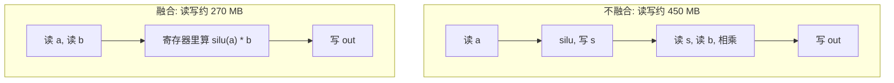

## Q
算子融合（operator fusion）为什么能加速？用一个"RMSNorm 之后接激活和乘法"的例子算一下融合前后的显存读写量。

## A
**背景：** 不融合时，每个算子是一个独立的内核（加速器上运行的函数）：从显存（HBM）读输入，计算，把结果写回显存，下一个算子再读回来。很多算子本身计算量很小（逐元素操作），时间几乎全花在读写显存上。

**例子：** 前馈网络里常见的一段（以 SwiGLU 结构为例）：两个矩阵乘法分别得到 `a` 和 `b`（形状都是 `[T, 11008]`，T 是 token 数），然后计算 `silu(a) * b`。

设 T = 4,096，BF16 每个数 2 字节，每个张量 4096 × 11008 × 2 字节 ≈ **90 MB**。

**不融合（两个内核）：**
1. `s = silu(a)`：读 a（90 MB），写 s（90 MB）。
2. `out = s * b`：读 s（90 MB）、读 b（90 MB），写 out（90 MB）。
- 共读写约 **450 MB**。

**融合成一个内核：**
- 读 a、读 b，在寄存器里算 `silu(a) * b`，写 out。
- 共读写约 **270 MB**，减少 40%，还省掉一次内核启动。

在 H100（约 3.35 TB/s）上，450 MB 约 134 微秒，270 MB 约 81 微秒。每层都有几处这样的组合，几十层累加起来很可观。

**更进一步的融合：**
- **把逐元素操作融合进矩阵乘法的收尾阶段（epilogue）：** 矩阵乘法算完一个输出块后，趁结果还在片上，直接做激活、加偏置、加残差，然后才写回。
- **归一化与量化融合：** RMSNorm 之后直接量化成 FP8，再交给下一个矩阵乘法。
- **注意力的融合（FlashAttention）：** 把打分、softmax、加权求和合成一个内核，不把巨大的分数矩阵写回显存。

**融合的风险（测试要点）：**
- 融合改变了中间结果的精度：不融合时中间结果按 BF16 写回再读出；融合后可能一直以 FP32 留在寄存器里。结果更准，但和逐个执行的结果不完全相同，测试要用容差。
- 融合规则写错（比如融合时用错了广播维度），只在特定形状下出错。测试需要覆盖多种形状。
