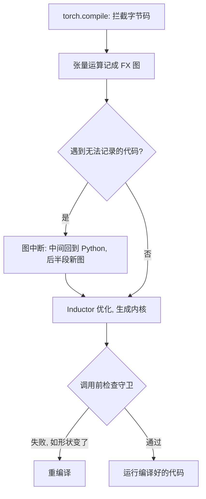

## Q
`torch.compile` 是怎样捕获计算图的？什么是图中断（graph break）、守卫（guard）和重编译（recompile）？它们对推理服务的性能和测试有什么影响？

## A
**TorchDynamo 捕获图的方式：** `torch.compile(model)` 在 Python 执行模型代码时拦截字节码，把遇到的张量运算记录成一张 FX 图（计算图），交给后端（默认是 Inductor）优化并生成内核（加速器上运行的函数）。普通 Python 逻辑（循环、条件）在捕获时被"展开"成具体的运算序列。

**图中断（graph break）：** 遇到无法记录进图的代码，比如打印张量的值、调用不支持的第三方库、依赖张量数值的 `if` 判断（`if x.sum() > 0`），Dynamo 就在此处把图切断：前半段编译，中间回到普通 Python 执行，后半段再编译一张新图。
- 后果：融合机会被切断，每次中断都有额外开销。一个模型被切成几十段时，编译几乎没有收益。

**守卫（guard）：** 编译出的代码只在某些假设下成立，比如"输入形状是 [8, 4096]""数据类型是 bfloat16""某个 Python 变量等于 True"。Dynamo 为每个假设生成检查条件，每次调用前先检查。

**重编译（recompile）：** 守卫检查失败（比如输入形状变了）时，重新编译一个新版本。推理服务的批大小和序列长度一直在变：
- 如果每种形状都重新编译，会频繁出现几秒到几十秒的停顿。
- 解决办法：标记动态维度（`torch._dynamo.mark_dynamic`），或者像推理引擎那样预先为一组固定的批大小编译，运行时把实际批大小向上取整。



**诊断工具：**

```bash
TORCH_LOGS="graph_breaks,recompiles" python serve.py   # 打印每次图中断和重编译的原因
```

```python
explanation = torch._dynamo.explain(model)(example_input)
print(explanation.graph_break_count, explanation.break_reasons)
```

**对测试的影响：**
- **性能测试要包含形状变化：** 只用固定形状测，看不到线上的重编译停顿。用不同批大小、序列长度交替发送，记录首次出现和稳定后的延迟。
- **数值测试要比较编译与不编译：** 融合改变了计算顺序和中间精度，结果和逐个算子执行有微小差异，按容差比较。
- **回归指标：** 图中断数和重编译次数可以作为模型代码变更的检查项，突然增加说明有人写了不兼容的代码。
