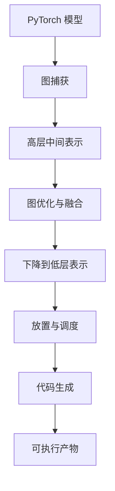

## Q
一个 ML 编译器把 PyTorch 模型变成能在加速器上运行的程序，要经过哪些阶段？每个阶段的输入输出是什么？

## A
**为什么需要编译器：** PyTorch 默认"逐个算子立即执行"（eager 模式）：每一行代码对应一次或几次 GPU 内核调用（内核：在加速器上运行的一个函数），中间结果都写回显存。这样灵活，但无法跨算子优化。编译器先把整个计算拿到手，再整体优化和生成代码。专用加速器（不是 GPU）更是必须经过编译器才能运行。

**各阶段：**
1. **图捕获（graph capture）：** 运行或分析 Python 代码，记录下算子及其依赖，得到计算图。工具如 `torch.compile` 的 TorchDynamo（拦截 Python 字节码）、`torch.export`（导出完整的静态图）。输出：FX 图，每个节点是一个算子，带形状和数据类型。
2. **高层中间表示（IR，intermediate representation）：** 把图转成编译器自己的表示，常见的有 XLA 的 HLO、基于 MLIR 的各种方言（dialect）。这一层仍然是"矩阵乘法、softmax"这样的算子级描述。
3. **图优化：** 常量折叠、删除无用计算、改变数据布局，以及最重要的**算子融合**：把连续的多个算子合成一个，中间结果不写回显存。
4. **下降（lowering）：** 逐层把高层算子翻译成更接近硬件的表示：循环、分块、向量指令、内存读写。
5. **放置与调度：** 决定每个计算在哪个计算单元、按什么顺序执行、数据放在哪一级存储。对 GPU 主要是选择分块大小和启动配置；对空间数据流架构（很多核心排成网格的芯片）则是把每层分配到网格的哪块区域、数据走哪条路径，类似芯片设计里的布局布线。
6. **代码生成：** 输出机器码或硬件指令。GPU 上常通过 Triton 或 CUDA 生成内核。
7. **可执行产物：** 运行时加载执行的文件，包含代码、内存布局和调度信息。

**测试视角：** 每个阶段都可能引入错误，而错误往往到最后才以"数值不对"的形式暴露。所以编译器测试既要有端到端的数值对比，也要有针对每个阶段输出的检查（比如检查融合后的图结构是否符合预期）。
