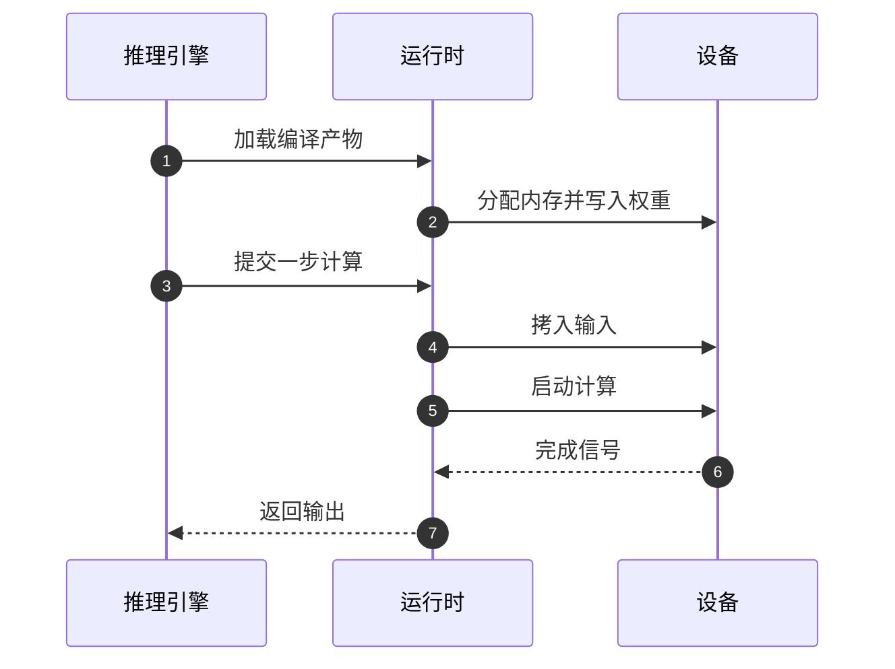

## Q
加速器的"运行时"（runtime）在推理系统里负责什么？它和编译器、驱动、推理引擎之间是怎样分工的？

## A
**分层（从上到下）：**
- **推理引擎：** 管请求：排队、凑批、管理 KV 缓存（每个请求历史 token 的中间结果）、采样、流式返回。
- **运行时：** 管执行：把编译好的程序加载到设备上，分配设备内存，搬运数据，按顺序启动计算，等待完成，报告错误。
- **编译器：** 在运行之前把模型变成设备能执行的程序（可执行产物）。
- **驱动和固件：** 管硬件：和设备通信、配置硬件、处理中断和底层错误。

GPU 上对应的例子：CUDA 运行时（`cudaMalloc`、`cudaMemcpyAsync`、内核启动）、cuBLAS 等库，以及 PyTorch 在其上的封装；驱动是 NVIDIA 内核模块。

**运行时的主要职责：**
- **加载：** 读取编译产物，校验它和当前设备、驱动版本是否兼容，把代码和常量写到设备上。
- **内存管理：** 为权重、KV 缓存、中间结果分配设备内存；管理内存池、处理碎片。
- **数据搬运：** 主机和设备之间（经 PCIe 或网络），多设备之间（经高速互连）。
- **调度与同步：** 按依赖顺序提交计算，用流（stream）和事件让拷贝与计算重叠，在需要时等待完成。
- **错误处理：** 把设备侧的错误（内存访问错误、超时、硬件故障）翻译成上层能理解的异常，必要时重置设备。
- **观测：** 提供计时、内存使用、硬件计数器等信息。

**为什么运行时值得重点测试：** 它处在"软件"和"硬件"的交界处。上层看到的很多问题（偶发挂起、显存缓慢增长、某些机器上出错、升级后变慢）根源在运行时和驱动的交互里。
