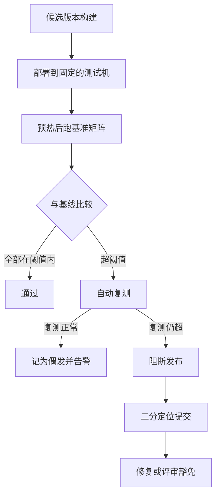

## Q
一个发布候选版本（release candidate）的性能门限流程应该是什么样的？从运行到阻断再到定位，画出流程并说明每一步。

## A
**发布候选版本：** 准备发布的一个固定构建，所有检查都针对它进行，不再混入新提交。

**每一步：**
1. **固定环境：** 用和基线相同型号、相同驱动的机器，最好是同一个机器池中经过筛选的、性能一致的机器。
2. **跑基准矩阵：** 按模型 × 配置 × 负载档位运行，每个格子重复几次，取中位数。
3. **比较：** 每个指标按各自阈值判断，输出一张"哪些格子退化、退化多少"的表格，而不是一个总分。
4. **自动复测：** 超阈值的格子自动重跑一次，排除机器抖动等偶发因素。
5. **阻断：** 复测仍然超标，阻止发布，并通知对应的负责人。
6. **定位：** 在上一个已知正常的版本和当前候选版本之间做二分查找：`git bisect start <坏提交> <好提交>`，再用 `git bisect run ./perf_check.sh`，脚本只跑退化的那个格子，返回 0 表示正常、1 表示退化。几十个提交只需跑五六轮。
7. **结论：** 修复后重新走流程；如果退化是有意的取舍（比如为了正确性修复而慢 4%），经评审签字后**豁免并更新基线**，记录原因。

**两个要点：**
- **定位脚本要足够快：** 只跑一个格子、较少的请求数，但仍需重复几次，保证判断可靠。
- **底层依赖也会引入退化：** 驱动、编译器、通信库的升级同样要过这个流程，二分查找的对象可以是依赖版本而不只是代码提交。
