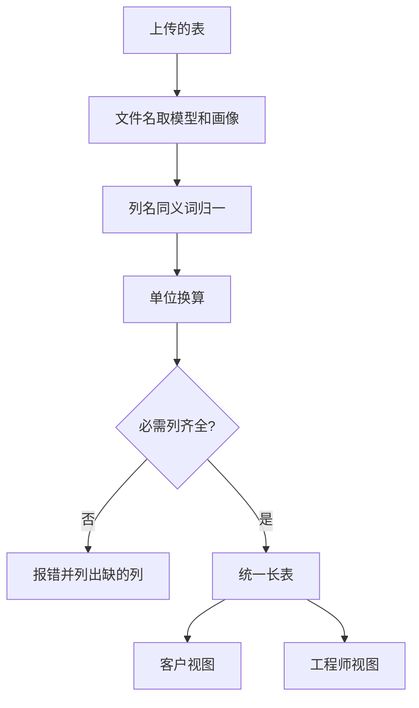

## Q
要做一个读推理服务性能扫描表的看板，下周会上传一个从没见过的新模型的表，要求不改一行代码就能正确显示。解析层怎么设计？

## A
**背景：** 每张表是一个大模型（逐个预测下一段文字的程序）在一种流量画像（输入长度、输出长度、缓存复用比例的组合）下的扫描结果，行是不同并发（同时在服务里的请求数），列是 TTFT（首字等待时间）、每用户 tok/s、总 tok/s 等。

**唯一可依赖的契约：** 文件名形如 `Model_<X>_profile_<N>.xlsx`，以及列的含义。列的顺序、大小写、单位写法都可能变。



```python
import re
NAME = re.compile(r"Model_(?P<model>[A-Za-z0-9]+)_profile_(?P<profile>\d+)")
SYNONYMS = {
    "conc":      {"concurrency", "batch size", "num users"},
    "ttft_ms":   {"ttft", "ttft (ms)", "time to first token"},
    "ttft_s":    {"ttft (s)"},                         # 秒，换算时乘 1000
    "user_tps":  {"tokens/s/user", "per-user tok/s"},
    "total_tps": {"total tokens/s", "throughput"},
}
REQUIRED = {"conc", "user_tps", "total_tps"}

def canon(header):
    h = " ".join(header.lower().split())               # 去大小写和多余空格
    return next((k for k, names in SYNONYMS.items() if h in names), None)

def parse(filename, headers):
    m = NAME.search(filename)
    if not m:
        raise ValueError(f"文件名不符合约定: {filename}")
    cols = {h: canon(h) for h in headers}
    missing = REQUIRED - set(cols.values())
    if missing:
        raise ValueError(f"{filename} 缺少列: {sorted(missing)}")
    return m["model"], int(m["profile"]), cols
```

**设计要点：**
- **按列名匹配，不按列序号：** 多一列、换顺序都不影响。
- **模型名单来自数据：** 模型列表从上传的文件名里收集，代码里没有任何写死的"A 到 K"。
- **认不出的列不丢：** 保留在工程师视图里，客户视图只用归一后的列。
- **失败要响亮：** 必需列缺失时报出"哪个文件缺哪一列"，不静默显示空图。
- **用测试守住契约：** CI 里放一份虚构的 `Model_L_profile_1.xlsx`，列名换成另一种写法、列序打乱，断言解析结果与标准表一致。新增同义词只改 `SYNONYMS` 这张表。
- **上传即生效：** 解析在请求时进行，不依赖重新构建或重新部署。
