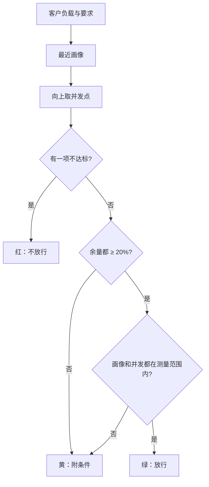

## Q
客户给出自己的负载和要求，怎样从推理服务的性能扫描表里给出红黄绿三档的上线结论？给客户和给内部部署工程师的视图有什么不同？

## A
**先说词：** token 是大模型（逐个预测下一段文字的程序）处理文字的单位；流量画像是一类请求的输入长度、输出长度和缓存复用比例；并发是同时在服务里的请求数；TTFT 是看到第一个字的等待时间；每用户 tok/s 是一个用户看到的出字速度。

**客户的输入：** 输入约 2,000 token、输出约 300 token、40 个用户同时在用；要求每用户 ≥ 50 tok/s、TTFT ≤ 1 s。

**判定步骤：**
1. **找最近的画像：** 按输入、输出长度的比例距离找，例如"输入 2,048 / 输出 256"。长度差超过 2 倍，就不算同一类负载。
2. **找并发点只向上取：** 表里测了 32 和 64，客户要 40，取 64。不在两点之间插值，插值会给出表里没有的乐观数字。
3. **比要求、算余量：** 64 并发实测每用户 62 tok/s、TTFT 0.7 s。速度余量 62 / 50 − 1 = 24%，TTFT 余量 1 − 0.7 / 1.0 = 30%。

**例子结论：** 绿。并且明说"取的是 64 并发的实测点（您需要 40，向上取最近点），画像输出 256 而您是 300"。20% 余量是一个可调的设计选择，用来吸收预测误差和流量波动。

**超出范围怎么办：** 客户要 200 并发，表里最高 128，判黄并写"超出测量范围，需要实测"，绝不外推成绿。

**两种人要的东西不同：**

| | 客户或产品经理 | 部署工程师 |
|---|---|---|
| 问题 | 我的负载能不能跑 | 这组预测可不可信 |
| 看什么 | 红黄绿、三四个关键数字 | 每个模型随并发的曲线、原始点 |
| 交互 | 输入负载和要求 | 换配置对比、筛异常 |
| 不给看 | 全部列 | 无，全部可下钻 |

把所有列都摊给所有人看不叫"可配置"，那是把判断推给了用户。
