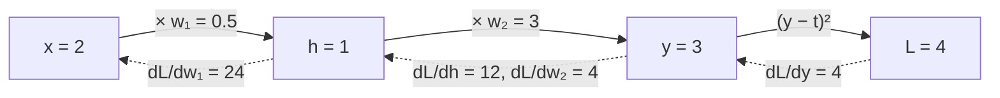

## Q
反向传播（backpropagation）在算什么？用一个两层的小网络手算一遍梯度。

## A
**目标：** 算出损失（衡量预测有多错的数字）对每个参数的导数，也就是梯度，告诉每个参数该往哪个方向调、调多少。

**工具：链式法则（chain rule）。** 如果 `L` 依赖 `y`，`y` 依赖 `w`，那么 `dL/dw = dL/dy × dy/dw`。网络是一层套一层的函数，所以从输出往输入，一层层乘下去即可。

**小网络：** 输入 x = 2，两个参数 w₁ = 0.5，w₂ = 3，目标 t = 1。

前向计算（从输入算到损失）：
- h = w₁ × x = 1
- y = w₂ × h = 3
- L = (y − t)² = 4

反向计算（从损失往回）：
- `dL/dy = 2(y − t) = 4`
- `dL/dw₂ = dL/dy × h = 4 × 1 = 4`
- `dL/dh = dL/dy × w₂ = 4 × 3 = 12`（继续往回传）
- `dL/dw₁ = dL/dh × x = 12 × 2 = 24`



**关键观察：**
- **复用：** 算 `dL/dw₁` 时直接用了已经算好的 `dL/dh`，不用从头算。整个网络的梯度只需一次反向遍历，代价约为前向计算的 2 倍。这就是反向传播高效的原因。
- **需要前向的中间结果：** 算 `dL/dw₂` 用到了 h，算 `dL/dw₁` 用到了 x。所以训练时前向计算的中间结果（激活值）都要先存下来，这是训练比推理多占大量内存的主要原因。
- **推理不需要反向传播：** 只做前向计算，中间结果用完即丢。

PyTorch 验证：

```python
x = torch.tensor(2.); w1 = torch.tensor(0.5, requires_grad=True); w2 = torch.tensor(3., requires_grad=True)
L = (w2 * (w1 * x) - 1) ** 2
L.backward()
print(w1.grad, w2.grad)    # tensor(24.) tensor(4.)
```
