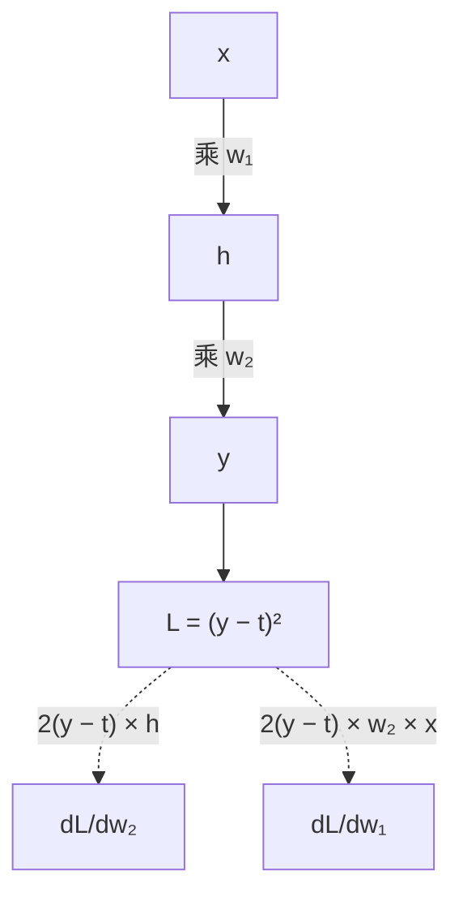

## Q
面试里被问"解释一下反向传播，梯度消失怎么解决"，怎么答？

## A
按这个顺序说：

- **一句话定义：** 反向传播是用链式法则，从损失往输入方向逐层计算每个参数梯度的算法。前向计算得到损失，反向一次遍历得到所有参数的梯度，代价约为前向的两倍。
- **举一个最小的例子：** h = w₁x，y = w₂h，L = (y − t)²。`dL/dw₂ = 2(y − t) × h`，`dL/dw₁ = 2(y − t) × w₂ × x`。往回传时复用上一层已算好的梯度，所以高效；而且要用到前向的中间值 h、x，这就是训练时必须保存激活值、显存比推理大得多的原因。

- **梯度消失和爆炸的成因：** 梯度要逐层连乘局部导数。sigmoid 的导数最大 0.25，10 层就小到 10⁻⁶ 量级，前面的层学不动；因子大于 1 时则指数增长，损失变 NaN。
- **解决办法，按重要性：** 残差连接给梯度一条直通路径；ReLU、GELU 这类激活函数在正区间导数不衰减；LayerNorm 或 RMSNorm 稳住每层的数值范围；合理初始化；爆炸用梯度裁剪，常见阈值 1.0。
- **怎么在实践中发现：** 监控每步的梯度范数（grad norm）和每层的梯度大小。前面层的梯度长期接近 0 是消失，范数突然尖峰是爆炸的前兆。
- **结合测试工作补一句：** 写一个自定义层时，用 `torch.autograd.gradcheck` 把自动求导的结果和数值差分比较，能验证反向实现是否正确；这和推理时把新实现与参考实现对比是同一个思路。
