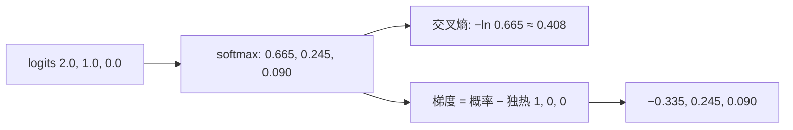

## Q
softmax 和交叉熵（cross-entropy）为什么总是配对使用？手算一次损失和梯度，并说明数值稳定的实现方法。

## A
**softmax：** 把一组任意实数分数（logits，模型最后一层的原始输出）变成和为 1 的概率：`p_i = e^(z_i) / Σ e^(z_j)`。

**交叉熵：** 损失 = `−log(正确类别的概率)`。正确类别概率越接近 1，损失越接近 0。

**手算：** 三个类别，logits = `[2.0, 1.0, 0.0]`，正确答案是第 1 类。
- softmax：e² ≈ 7.389，e¹ ≈ 2.718，e⁰ = 1，总和 11.107 → 概率 `[0.665, 0.245, 0.090]`。
- 损失 = −ln 0.665 ≈ **0.408**。

**配对的好处——梯度非常简洁：** 损失对每个 logit 的梯度 = **预测概率 − 正确答案的独热向量**（正确类为 1、其余为 0 的向量）。
- 这里梯度 = `[0.665 − 1, 0.245, 0.090]` = `[−0.335, 0.245, 0.090]`。
- 含义：正确类的分数被往上推，其他类按各自概率往下推。错得越多，推得越猛，不会因为饱和而停止学习。
- 如果用均方误差配 softmax，梯度里会多乘一个 p(1 − p) 因子，p 接近 0 或 1 时梯度几乎消失。



**数值稳定实现：**
- 不要先算 softmax 再取 log：概率很小时会被舍入成 0，log(0) = −∞。
- 用 log-softmax：`log p_i = z_i − max(z) − log Σ e^(z_j − max(z))`，先减最大值防止 e 的指数溢出，再整体在对数空间计算。
- PyTorch 的 `nn.CrossEntropyLoss` 直接接收 logits，内部就是这么做的。**不要先自己做 softmax 再传进去**，那样等于做了两次 softmax，模型照样能训练，但学得慢且结果不对，是常见 bug。

```python
logits = torch.tensor([[2.0, 1.0, 0.0]]); target = torch.tensor([0])
print(torch.nn.functional.cross_entropy(logits, target))   # tensor(0.4076)
```

大语言模型的训练损失就是它，类别是词表里的几万个 token。
