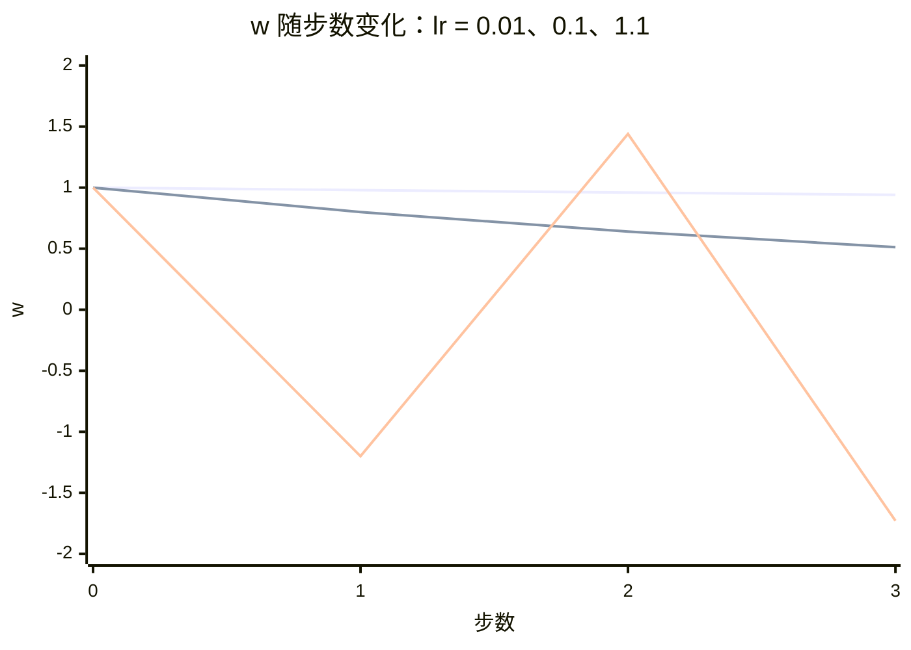

## Q
梯度下降（gradient descent）的学习率（learning rate）太大或太小会怎样？用一个一元函数手算几步说明。

## A
**梯度下降一步：** `w ← w − 学习率 × 梯度`。梯度（gradient）是损失对参数的导数，指向损失**上升**最快的方向，所以减去它就是往下走。学习率决定每步走多远。

**例子：** 损失 `L(w) = w²`，最低点在 w = 0。梯度 = 2w。从 w = 1 出发。

| 学习率 | 第 1 步 | 第 2 步 | 第 3 步 | 结果 |
|---|---|---|---|---|
| 0.01 | 0.98 | 0.960 | 0.941 | 太慢，几百步才接近 0 |
| 0.1 | 0.8 | 0.64 | 0.512 | 稳定收敛 |
| 0.5 | 0 | 0 | 0 | 一步到位（恰好是这个函数的最优值） |
| 1.1 | −1.2 | 1.44 | −1.728 | 来回跳且越跳越远，**发散** |

计算方法：每步 `w_new = w − lr × 2w = w × (1 − 2 × lr)`。`|1 − 2 × lr| > 1` 就发散。

**真实训练中的表现：**
- **太大：** 损失曲线剧烈震荡，或突然变成 NaN（不是数字，数值溢出）。
- **太小：** 损失下降极慢，花了大量算力还没收敛，也可能卡在不太好的位置。

**实践做法：**
- **预热（warmup）：** 开始几百到几千步从很小的学习率线性升高，避免一开始参数随机时步子太大。
- **衰减（decay）：** 后期逐渐降低学习率（常用余弦衰减），在最低点附近细调。
- **典型数值：** 用 Adam 优化器训练大语言模型时峰值学习率常在 1e-4 到 3e-4 量级，模型越大一般越小。

**工程上的检查：** 训练出现 NaN 时，第一个怀疑对象就是学习率过大或数值精度不够。
