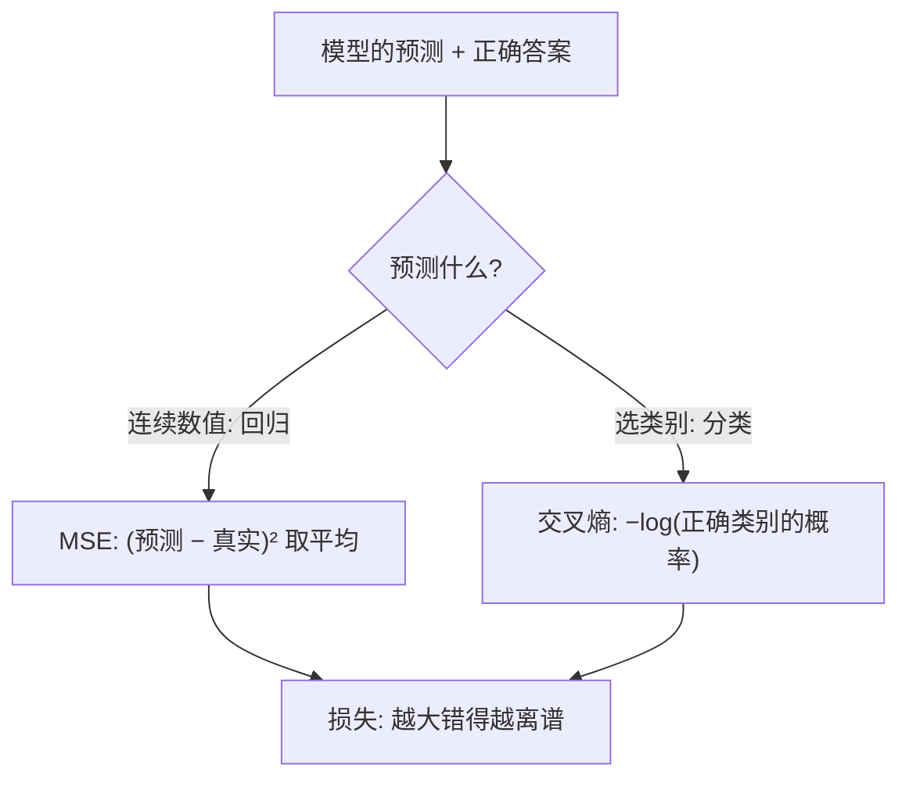

## Q
什么是损失函数（loss function）？回归用的均方误差（MSE）和分类用的交叉熵（cross-entropy）各怎么算？各手算一个例子。

## A
**损失函数：一个把"模型的预测"和"正确答案"变成一个数字的函数，数字越大表示错得越离谱。** 训练的全部目标就是调整参数（模型里可调的数字），让这个数字变小。

**均方误差（MSE，mean squared error）：用于预测一个连续数值（回归，regression）。**
- 公式：每个样本的 `(预测 − 真实)²`，再取平均。
- 手算：预测房价 `[300, 410]` 万，真实 `[320, 400]` 万。误差平方 `[400, 100]`，平均 **250**。
- 平方的作用：正负误差不会抵消；大误差被放大，模型会优先修正离谱的预测。

**交叉熵（cross-entropy）：用于从几个类别里选一个（分类，classification）。**
- 模型先输出每个类别的概率，损失 = `−log(模型给正确类别的概率)`。
- 手算：判断图片是猫、狗、鸟，正确答案是猫。
  - 模型给猫 0.7：损失 = −ln 0.7 ≈ **0.36**；
  - 模型给猫 0.1：损失 = −ln 0.1 ≈ **2.30**；
  - 模型给猫 0.99：损失 ≈ 0.01。
- 特点：对"非常自信地答错"惩罚极重（概率趋近 0 时损失趋近无穷大）。

**为什么分类不用 MSE：** 分类时概率经过 softmax（把分数变成和为 1 的概率）之后再用 MSE，模型错得很离谱时梯度反而很小，学得慢；交叉熵配 softmax 时梯度恰好是"预测概率 − 正确答案"，错得越多推得越猛。

**大语言模型的损失：** 就是交叉熵，类别是词表里的每个 token（文字切成的小片段），正确答案是真实的下一个 token。损失的指数（e 的损失次方）就是常说的困惑度（perplexity）。
