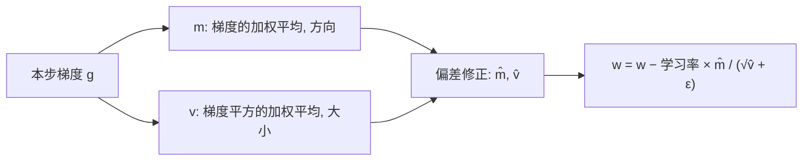

## Q
Adam 优化器是怎样工作的？它的默认超参数是多少？为什么说它给每个参数"自适应"的学习率？

## A
Adam（adaptive moment estimation）为每个参数维护两个统计量：

- **一阶矩 m：** 梯度的指数加权平均，等同于动量，记录"一直往哪个方向走"。
- **二阶矩 v：** 梯度平方的指数加权平均，记录"这个参数的梯度通常有多大"。

**更新步骤（g 是本步梯度）：**

```python
m = β1 × m + (1 − β1) × g
v = β2 × v + (1 − β2) × g²
m̂ = m / (1 − β1^t),  v̂ = v / (1 − β2^t)     # 偏差修正，t 是步数
w = w − 学习率 × m̂ / (√v̂ + ε)
```



**PyTorch 默认值：** `torch.optim.Adam(params, lr=1e-3, betas=(0.9, 0.999), eps=1e-8)`。

**"自适应"的含义：** 每个参数的实际步长 ≈ 学习率 × m̂ / √v̂。
- 梯度一直很大的参数，除以一个大的 √v̂，步子变小，不会冲过头；
- 梯度一直很小的参数（比如很少出现的词对应的参数），除以小的 √v̂，步子相对变大，学得动。
- 所以不同参数即使梯度量级差 1000 倍，也能用同一个学习率。

**偏差修正为什么需要：** m 和 v 从 0 开始，前几步会被严重低估。第 1 步时 1 − 0.9¹ = 0.1，除以它把 m 放大 10 倍，恢复到合理大小。

**代价：内存。** 每个参数多存 m 和 v 两个 FP32 数，即 8 字节。7B 模型光优化器状态就是 56 GB，比 FP16 权重（14 GB）大 4 倍。这只影响训练，推理时不需要优化器。
