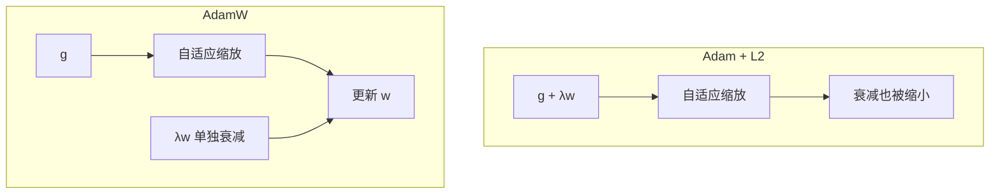

## Q
AdamW 和"Adam 加 L2 正则"有什么区别？为什么大模型训练普遍用 AdamW？

## A
**先说权重衰减（weight decay）：** 每一步把每个参数按比例缩小一点，比如乘以 0.9999，防止参数变得过大，起到正则化（防止模型死记训练数据）的作用。

**在普通 SGD 里，L2 正则等价于权重衰减：** L2 正则是在损失上加 `λ/2 × Σw²`，它的梯度是 `λw`，更新时 `w ← w − 学习率 × (g + λw)`，效果就是每步按比例缩小 w。

**在 Adam 里，两者不再等价：**
- **Adam + L2：** 把 `λw` 加进梯度 g，然后这个和会被 Adam 的自适应缩放（除以梯度平方的平均的平方根）处理。结果：梯度一直很大的参数，衰减也被缩小了，正则效果在不同参数上不均匀，往往偏弱。
- **AdamW（解耦权重衰减，decoupled weight decay）：** 梯度部分照常走 Adam，衰减单独做，不经过自适应缩放：

```python
w = w − 学习率 × (m̂ / (√v̂ + ε) + λ × w)
```

每个参数都按同样的比例衰减，行为可预测。



**为什么大模型用 AdamW：**
- 实验上泛化更好，而且学习率和衰减强度可以分开调。
- PyTorch：`torch.optim.AdamW(params, lr=3e-4, weight_decay=0.1)`。框架默认 `weight_decay=0.01`，大语言模型训练常用 0.1。
- 通常对偏置和归一化层的参数不做衰减，按参数分组设置。

**测试角度：** 比较两次训练结果时，优化器类型、`weight_decay` 和"哪些参数被排除在衰减外"都要相同；把 Adam 换成 AdamW 而不改 λ，等于换了一个完全不同的正则强度。
