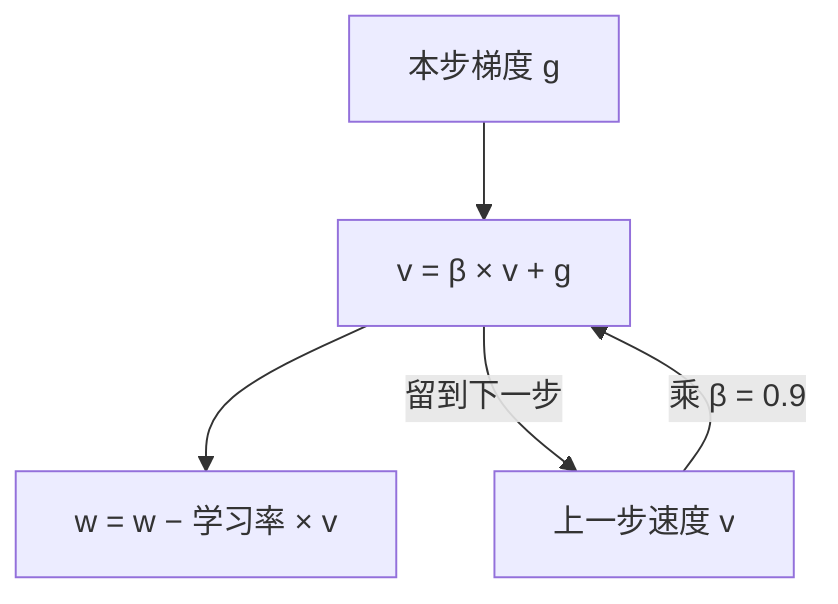

## Q
普通 SGD 有什么问题？动量（momentum）是怎样改进它的？写出更新公式并说明直觉。

## A
**普通 SGD（随机梯度下降，每步用一小批样本算梯度并更新参数）的两个问题：**
- **山谷里来回震荡：** 如果损失函数在一个方向很陡、另一个方向很平（像一条窄长的山谷），梯度主要指向陡的山壁，参数在两壁之间来回跳，沿着谷底前进很慢。
- **噪声：** 每一小批算出的梯度都有随机误差，方向时好时坏。

**动量的做法：** 不直接用当前梯度，而是维护一个"速度" v，它是过去梯度的指数加权平均：

```python
v = β × v + g        # g 是本步梯度，β 通常取 0.9
w = w − 学习率 × v
```



**直觉：** 像一个滚下山的球，有惯性。
- 方向一致的分量（沿谷底向前）一步步累加，越走越快。β = 0.9 时，稳定方向上的有效步长约放大到 1 / (1 − 0.9) = **10 倍**。
- 来回反复的分量（在两壁间左右摆动）正负抵消，被抑制。
- 单步的噪声被平均掉一部分。

**手算一步：** β = 0.9，学习率 0.1，前一步 v = 2，本步梯度 g = 1。v = 0.9 × 2 + 1 = 2.8，w 减少 0.28。只用 SGD 时 w 只减少 0.1。

**代价：** 每个参数要额外存一个速度值，7B 参数用 FP32 存就是 28 GB。动量太大（如 0.99）在拐弯处会冲过头。

PyTorch：`torch.optim.SGD(params, lr=0.1, momentum=0.9)`。
