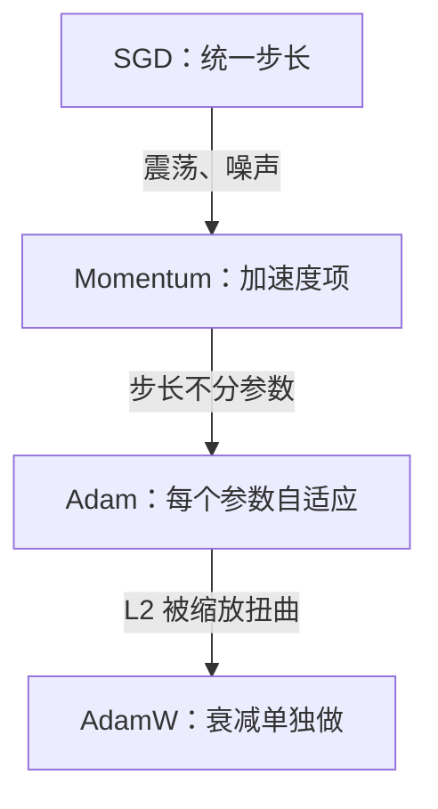

## Q
面试里被问"SGD、Momentum、Adam 有什么区别？大模型为什么用 AdamW？"，怎么答？

## A
按演进顺序讲，每一种都说"解决了上一种的什么问题"：

- **SGD：** 每步用一小批样本算梯度（损失对参数的导数），参数沿负梯度方向走一步，步长是统一的学习率。问题是在一个方向陡、一个方向平的地形上来回震荡，而且小批量的梯度有噪声。
- **Momentum：** 加一个速度项，`v ← 0.9v + g`，用 v 更新。像有惯性的球，稳定方向累积加速，来回摆动的方向相互抵消。β = 0.9 时稳定方向的有效步长约放大 10 倍。
- **Adam：** 在动量之外再记录梯度平方的平均，用它的平方根去除，每个参数得到自适应的步长：梯度大的走小步、梯度小的走大步。再加偏差修正，弥补从 0 起步的低估。默认 lr = 1e-3，β = (0.9, 0.999)，ε = 1e-8。代价是每个参数多 8 字节状态，7B 模型多 56 GB。
- **AdamW：** 把权重衰减从梯度里拿出来单独做。Adam 里的 L2 正则会被自适应缩放扭曲，梯度大的参数几乎不衰减；AdamW 让每个参数按同样比例衰减，泛化更好，也方便分开调学习率和衰减。大模型常用 lr 约 3e-4、weight_decay 0.1，配预热和余弦衰减。

- **什么时候用 SGD：** 一些视觉任务里精调过的 SGD + Momentum 泛化仍然很好，内存也更省；但 Transformer 用 SGD 很难训练稳定，所以语言模型几乎都用 AdamW。
- **补一句和推理的关系：** 优化器只存在于训练中，推理服务加载的权重文件里不含 m、v；如果看到检查点体积是权重的 3 倍以上，多半是带上了优化器状态，部署前应该剥离。
