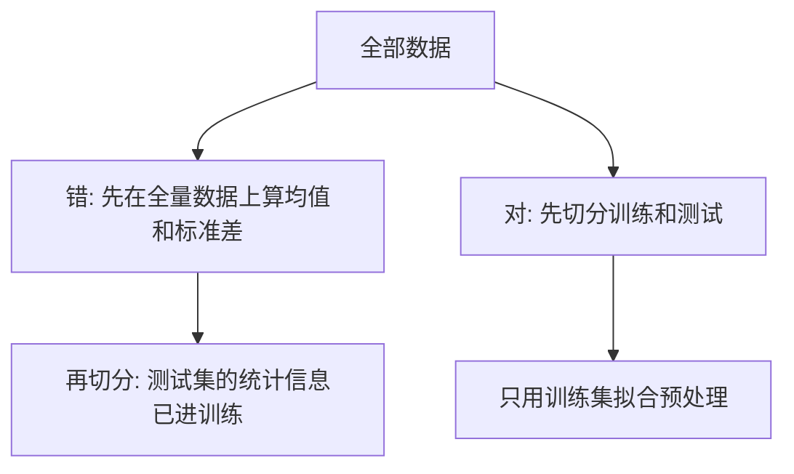

## Q
什么是数据泄漏（data leakage）？举几个常见例子，包括大语言模型评测里的"测试集污染"，以及怎样检测。

## A
**数据泄漏：训练过程用到了"上线后不可能拿到"或"本应只在评估时出现"的信息，导致评估分数虚高，上线后表现大幅下滑。** 它是最隐蔽的一类机器学习缺陷，因为一切指标看起来都很好。

**常见例子：**
- **训练集和测试集有重复：** 同一个用户的多条记录、同一张图的多个裁剪版本被随机分到两边。模型在测试集上"认出"了样本，而不是真正学会。应该按用户或按来源分组切分。
- **用到了未来信息：** 预测客户是否会流失，特征里却有"注销日期"字段。
- **预处理在全量数据上做：** 先用全部数据算平均值和标准差做归一化，再切分训练和测试，测试集的统计信息就泄漏进了训练。正确顺序是先切分，只用训练集拟合预处理。
- **大语言模型的测试集污染（contamination）：** 公开评测集的题目和答案出现在网上，被爬进了预训练语料。模型在这些题上分数很高，换一批同等难度的新题就明显下降。

**检测办法：**
- **查重：** 训练集和测试集之间做精确哈希和近似去重（例如按 13 个连续词的片段重叠率），重叠率高就是污染。
- **"好得不像真的"：** 某个简单模型就达到 99% 准确率，先怀疑泄漏，看哪个特征贡献最大。
- **换一份新题：** 同分布、新收集的测试题上的分数和公开测试集差距很大，说明有污染。
- **流程保障：** 切分逻辑写成代码、固定随机种子并做版本管理；测试集只由专人在最后使用。
