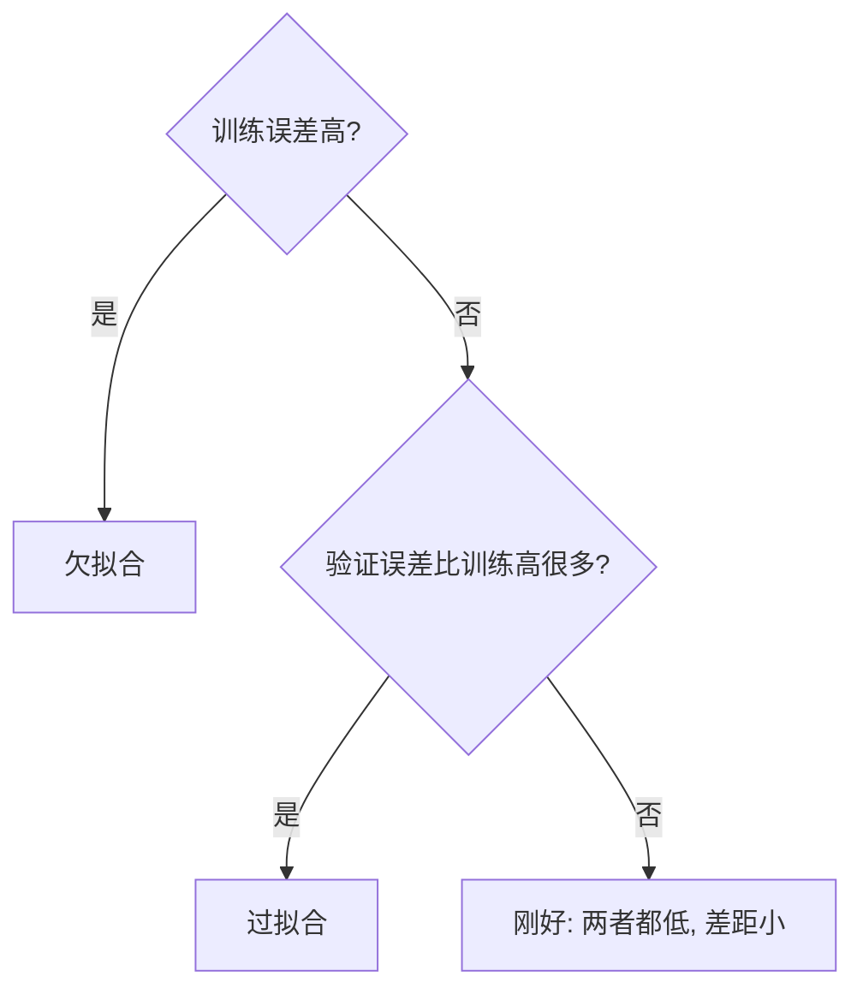

## Q
什么是过拟合（overfitting）和欠拟合（underfitting）？怎样从训练集和验证集的表现上分辨它们？

## A
**机器学习真正的目标是在"没见过的新数据"上表现好，这叫泛化（generalization）。** 在训练数据上表现好只是手段。

- **欠拟合：** 模型太简单或训练不够，连训练数据都没学好。训练集误差高，验证集误差也高。比如用一条直线去拟合明显弯曲的数据。
- **过拟合：** 模型把训练数据里的噪声和偶然细节也背了下来。训练集误差很低，但在新数据上明显变差。比如用 20 次多项式穿过 21 个带噪声的点，曲线每个点都对上了，点和点之间却剧烈摆动。
- **刚好：** 训练集和验证集误差都低，两者差距小。

**用两条损失曲线判断（横轴是训练步数）：**

| 现象 | 训练损失 | 验证损失 | 诊断 |
|---|---|---|---|
| 两条都高且平 | 高 | 高 | 欠拟合 |
| 两条一起降 | 降 | 降 | 正常，继续训 |
| 训练还在降、验证开始升 | 降 | 升 | 过拟合开始 |

**例子数字：** 训练集准确率 99%、验证集 75%，差 24 个点，典型过拟合；训练 70%、验证 69%，差距小但都低，欠拟合。

**应对：**
- **欠拟合：** 用更大的模型、训练更久、加更有用的特征、降低正则强度。
- **过拟合：** 增加数据、做数据增强、加正则化（在损失里惩罚过大的参数，如 L2；或训练时随机丢弃一部分中间结果，即 dropout）、早停（验证损失不再下降时停止）、缩小模型。

**大语言模型的特殊之处：** 预训练数据量极大，通常只过一遍，很少出现经典过拟合；但在小数据集上微调时很容易过拟合，表现为对训练里的问题对答如流，换个问法就变差。
