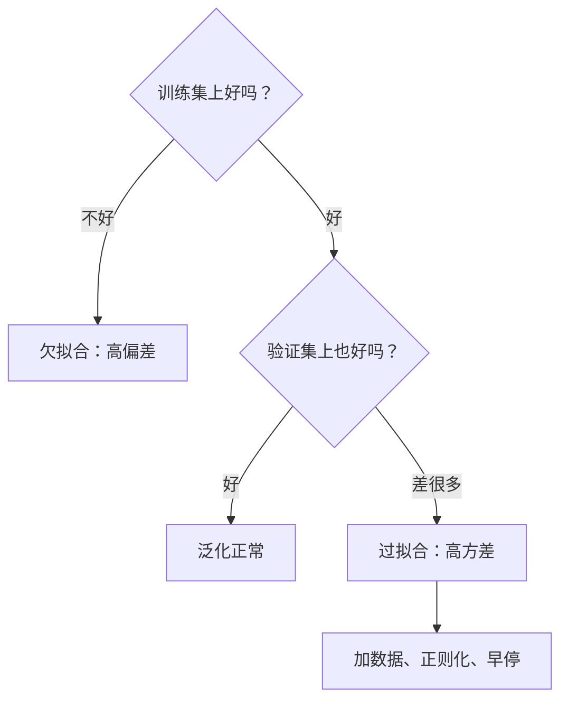

## Q
面试里被问"什么是过拟合？你怎么发现和解决？"，怎么答？

## A
按这个顺序说：

- **定义：** 模型在训练数据上表现很好，在没见过的数据上明显变差，说明它记住了训练数据里的噪声，而不是学到了可推广的规律。反面是欠拟合，连训练数据都没学好。
- **怎么发现：** 把数据分成训练、验证、测试三份。看损失曲线：训练损失持续下降而验证损失开始上升，就是过拟合开始的位置。数字上，训练准确率 99%、验证 75% 这种大差距就是典型信号。

- **偏差和方差的说法：** 欠拟合是高偏差（模型假设太简单，系统性地偏），过拟合是高方差（对训练数据的偶然变化太敏感，换一批训练数据结果差很多）。模型复杂度增加时，偏差下降、方差上升，要找中间点。
- **怎么解决，按优先级：** 先加数据或做数据增强，这通常最有效；再加正则化，也就是在损失里惩罚过大的参数（L2 权重衰减），或训练时随机丢弃一部分中间结果（dropout）；用验证集做早停；最后考虑缩小模型或减少特征。
- **提一下数据泄漏：** 验证分数异常好时，先排除训练集和验证集有重复、预处理在全量数据上做、用了未来信息这几类泄漏，否则所有结论都不成立。
- **连到测试工程：** 测试集只在最后用一次，类似发布前的最终回归，不能拿它反复调参；大模型评测还要查测试题是否被爬进了训练语料。

一分半钟左右讲完，被追问时再展开 L1、L2 或交叉验证的细节。
