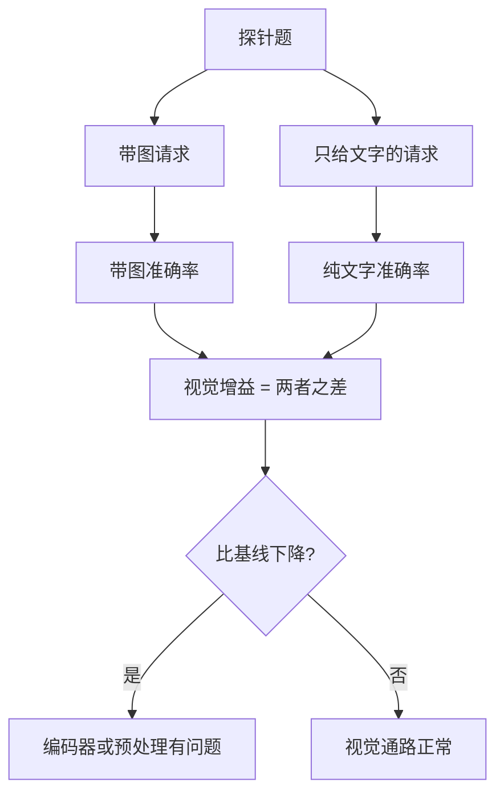

## Q
一个能看图的大模型有约 1.15 万道图文评测题，跑全量太贵。怎样挑一个便宜的探针集，专门发现"视觉编码器退化"，而不是泛泛地测能力？只能通过 OpenAI 兼容接口调用模型。

## A
**先说词：**
- **大模型（LLM）：** 读入文字、预测后续文字的程序。
- **多模态模型：** 还能读图。图片先经过**视觉编码器（vision encoder）**，即一个把图片切成小块、变成一串向量（一组数字）的网络，再和文字一起交给语言模型。
- **编码器退化：** 编码器被量化（用更少的位数存数字）、换了图片预处理（缩放方式、颜色通道顺序）后"看得更差"，但不报错。

**随机抽样为什么测不准：** 大量题只看文字就能答对，或者主要考学科知识。随机抽的题里，真正依赖看图的只占一部分，编码器坏了，分数只掉一点，淹没在噪声里。

**探针集的做法：**
1. **只留依赖图片的题：** 用一个健康的参考部署，每题跑两次：带图、只给文字。保留"带图答对、只给文字答错"的题。只看文字就能答对的题，编码器坏了也照样对，没有探测价值。
2. **按图片类型分层：** 图表、表格、小字、公式、化学结构、需要看细节的高分辨率图，这些最考验编码器；每类各取几十题，结果按类别报。
3. **算视觉增益：** 视觉增益 = 带图准确率 − 只给文字准确率。

4. **读结果：** 视觉增益下降、纯文字准确率不变 → 问题在看图这条路；纯文字准确率也降 → 问题在语言模型本身。
5. **扰动曲线：** 把图片降采样到一半、JPEG 压到低质量、裁掉边缘，各跑一遍。健康的编码器准确率平滑下降；某一类图在轻微扰动下就崩，是值得报告的信号。

**接口：** 图片放在消息的 `content` 数组里，`{"type": "image_url", "image_url": {"url": "data:image/png;base64,..."}}`；纯文字版本去掉这一项，题干不变。温度设 0，减少随机性。

**比随机抽样多给了什么：** 同样几百题，信号集中在"看图"这一条路上，还能指出是哪一类图出了问题。
