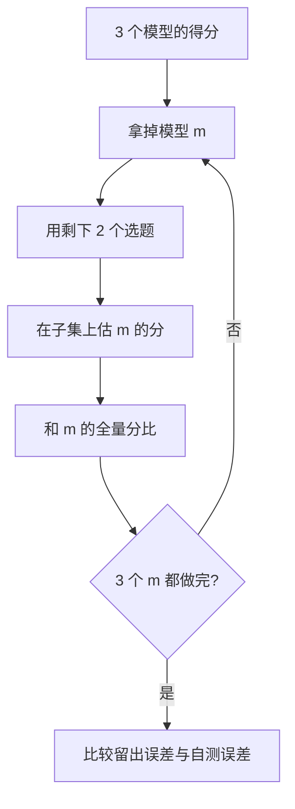

## Q
压缩大模型评测集时只有 3 个模型的逐题得分，子集上 Kendall τ = 1。这个证据有多强？怎样用留一模型法检查选题是否只对这 3 个模型有效？用另一个大模型当评委打分时，评委噪声怎么计入？

## A
**背景：** 大模型（LLM）是读入文字、预测后续文字的程序；评测集是一组带自动打分的题。Kendall τ 衡量两种排序是否一致：两两配对，τ = (同向对数 − 反向对数) / 总对数。

**3 个模型只有 3 对，别夸大：**
- τ 只能取 −1、−1/3、1/3、1 四个值。
- 随便打乱 3 个模型的顺序，有 1/6 ≈ 17% 的概率刚好 τ = 1。
- 如果三个模型全量分数是 72% / 66% / 58%，相差很大，几乎任何像样的子集都能保住顺序。所以 τ = 1 只说明"没出错"，不说明"选得好"。要在讲义里明说这一点。

**留一模型法（leave-one-model-out）：** 选题时故意不看一个模型，用它来检验。

- 留出模型的误差和结论，如果和"用全部 3 个模型选题再自测"差不多，方法能推广到新模型；明显更差，说明选题贴合了这 3 个模型。
- **少依赖具体模型：** 分层用题目自带的特征（难度标签、题型、输入长度），模型得分只用来在层内排先后。
- **上线后持续核对：** 前几个新模型，子集和全量都跑，累计对照数据，再决定是否只跑子集。

**评委噪声下限（judge noise floor）：** 长上下文推理这类题由另一个大模型读答案和参考答案后判对错，同一答案重判可能结论不同。
- **量法：** 同一批答案让评委重判 5 次，算每题翻转的比例和总分的标准差。
- **例子：** 若 5% 的题每次判对的概率是一半，单题方差约 0.05 × 0.25 = 0.0125；子集 30 题时，总分标准差 ≈ √(0.0125 / 30) ≈ 2 个百分点，全量 100 题时约 1.1 个百分点。
- **用法：** 子集和全量之差、两个模型之差小于约 2 倍评委标准差时，不解读为真实差异。
- **压低噪声：** 评委温度设 0、固定评委模型版本、对结论摇摆的题取 3 次多数票。
