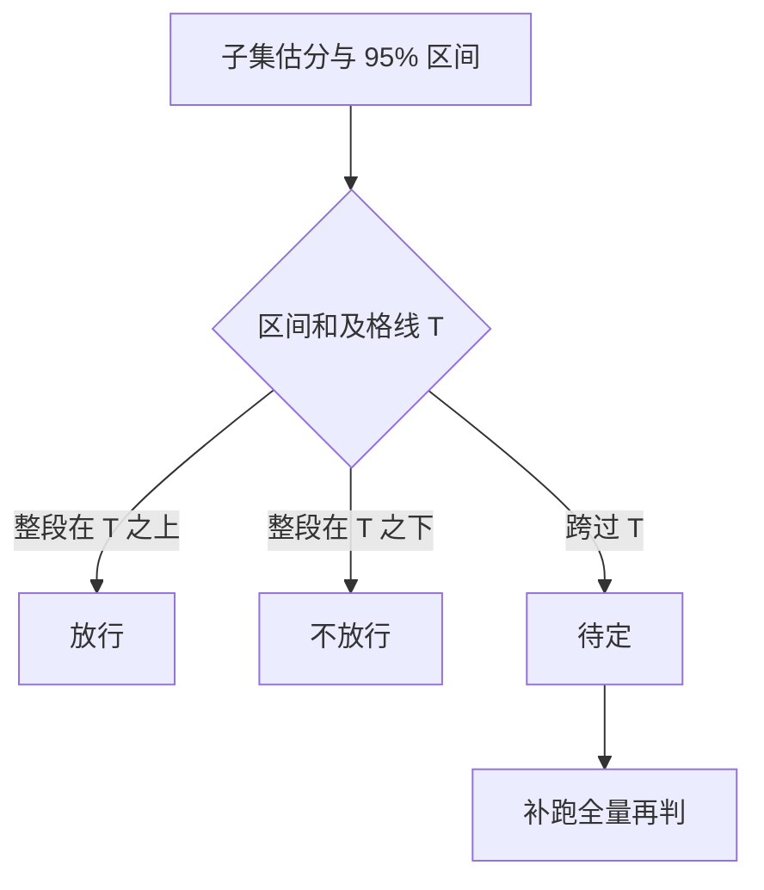

## Q
把大模型评测集从 315 题剪到 47 题后，怎样证明这个子集"还可信"？分数误差、Kendall τ 排名一致、放行结论一致各怎么算，子集结论拿不准时怎么办？

## A
**背景：** 大模型（LLM）是读入文字、预测后续文字的程序；评测集是一组带自动打分的题，模型得分 = 答对比例。手上有每个模型在全部 315 题上的逐题得分，所以子集的结论可以直接和全量对照。

**三项检查：**
1. **分数误差：** 每个模型 |子集估分 − 全量分|，取平均叫平均绝对误差（MAE）。例：全量 72% / 66% / 58%，子集估 70% / 67% / 55%，MAE = (2 + 1 + 3) / 3 = 2 个百分点。
2. **排名一致（Kendall τ）：** 把模型两两配对，看两种排序是否同向。τ = (同向对数 − 反向对数) / 总对数，1 表示完全一致，−1 表示完全相反。例：全量 A > B > C，子集 A > C > B。三对里 (A,B)、(A,C) 同向，(B,C) 反向，τ = (2 − 1) / 3 = 1/3。代码里用 `scipy.stats.kendalltau(full, sub)`。
3. **放行结论一致：** 在客户的及格线 T 上，每个模型"过线 / 不过线"两边是否相同。及格线不止一条时，在 50%–80% 之间每隔 1 个百分点扫一遍，报一致的比例。

**单次结论拿不准时：** 用自助法（bootstrap）：从选中的 47 题里有放回地抽 47 题，重算估分，重复 1,000 次，取第 2.5 和 97.5 百分位作为 95% 区间。再按区间和及格线的位置给结论：

**为什么要有"待定"这一档：** 47 题的区间宽度通常有 ±10 个百分点以上。模型离及格线很远时，小子集足够；离线很近时，任何小子集都给不出可信结论，诚实的做法是升级到全量。这和测试分档一样：冒烟套件只负责快速排除明显的好坏，边界情况交给完整回归。

**剪了多少要和误差一起报：** "315 → 47 题，成本降到 15%，MAE 2 个百分点，τ = 1，扫描的 31 条及格线上结论一致 30 条"，比只报一个压缩比可信得多。
