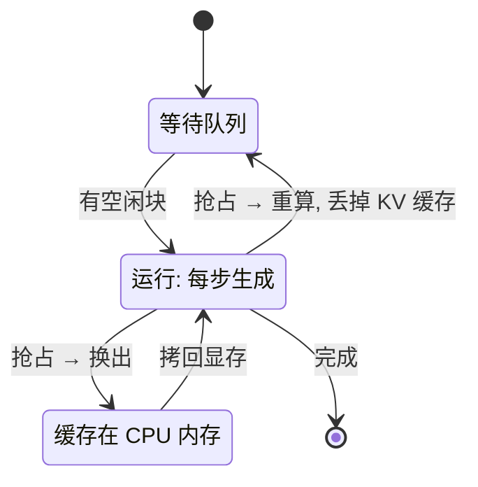

## Q
推理引擎的 KV 缓存显存用完了会发生什么？什么是抢占（preemption），"重算"和"换出"两种方式各有什么代价？怎样测出它在发生？

## A
**背景：** KV 缓存保存每个请求的历史 token 在每一层的键（K）和值（V）向量，生成时每步都要读它。它随输出变长不断增长。vLLM 这类引擎把缓存切成固定大小的块（比如每块 16 个 token），按需分配。引擎会乐观地接收很多请求，因为事先不知道每个请求最终会生成多长。

**显存用完时：** 某一步里有请求需要新块，但没有空闲块了。引擎必须挑一些正在运行的请求（通常是最晚到达、优先级最低的）暂停，释放它们的块，这就是**抢占**。

**两种恢复方式：**
- **重算（recompute）：** 直接丢掉被抢占请求的 KV 缓存。等显存空出来时，把它的"原始输入 + 已生成部分"当成新输入重新做一次预填充（一次性并行处理整段文本）。代价是重复计算；好处是不占其他存储，实现简单。vLLM V1 引擎只用重算，旧的换出方式已被移除。
- **换出（swap）：** 把缓存块拷贝到 CPU 内存，之后再拷回来。代价是 PCIe 带宽（每方向约几十 GB/s）和 CPU 内存占用；缓存很大时拷贝本身就要几十毫秒。

**对用户的影响：** 被抢占的请求输出中途卡住，从几百毫秒到几秒不等，表现为 TPOT（每 token 间隔）的 P99 出现尖峰。抢占频繁时，系统在反复重算，有效吞吐反而下降。

**怎样测出来：**
- vLLM 的 Prometheus 指标里，缓存使用率 `vllm:kv_cache_usage_perc`（0 到 1）持续贴近 1，同时被抢占的请求回到等待队列，`vllm:num_requests_waiting` 上升；引擎日志也会记录抢占事件。
- 压测：用长输出（比如 4,000 token）、高并发的负载，把缓存打满，观察抢占计数、TPOT 尖峰和最终输出是否正确。

**正确性要求：** 被抢占后恢复的请求，在贪心解码（每步取概率最高的 token）下，输出应与没被抢占时一致（或只在数值上非常接近的地方分叉）。这是一个容易漏测的场景：抢占恢复时位置编号、已生成 token、停止条件状态都必须正确续上。
