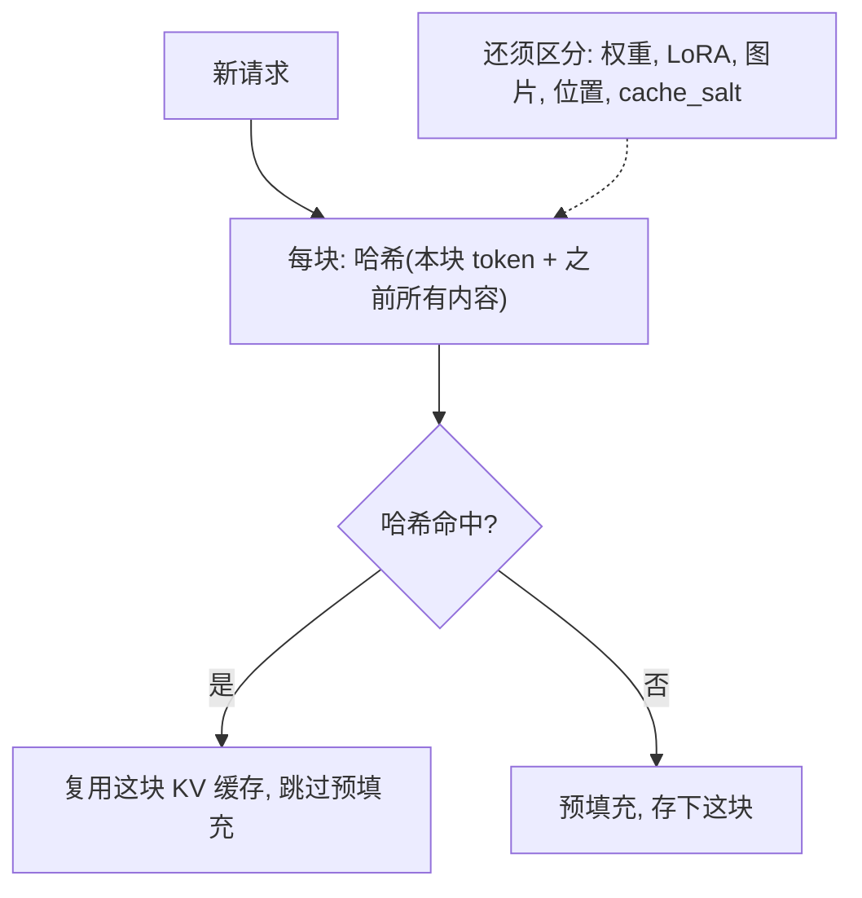

## Q
前缀缓存（prefix caching）复用别的请求算过的 KV 缓存，会带来哪些正确性和安全风险？怎样测试？

## A
**前缀缓存：** 很多请求以相同的文字开头（同一段系统提示、同一份文档）。这段开头的 KV 缓存（每层的键、值向量）算过一次就留在显存里，后续请求开头相同的部分直接复用，跳过重复的预填充（一次性处理输入的计算），首 token 延迟大幅下降。引擎通常按"块"判断：对每块 token 内容连同它之前所有内容算哈希值，哈希相同就认为可以复用。

**正确性风险：**
- **"开头相同"判断不完整：** KV 缓存不只取决于 token 本身，还取决于模型权重、LoRA 适配器（在基础模型上叠加的小型可替换参数）、多模态输入（同样的占位 token 背后是不同图片）、位置编号。哈希里漏了其中任何一项，就会把不该复用的缓存给错误的请求，输出被"别人的上下文"污染。
- **哈希碰撞：** 弱哈希在海量块下可能碰撞，用强哈希能把概率降到可忽略。
- **块被回收后又被读：** 引用计数出错时，一个块被淘汰并分给别人，原来的请求还在读它。

**安全风险：**
- **跨租户的时间侧信道：** 攻击者发送一个猜测的前缀，如果首 token 延迟明显变短，就说明别人最近发过相同的前缀，可能泄露其他用户的提示内容。缓解方法是按租户隔离缓存，vLLM 支持在请求里传 `cache_salt`，不同的盐值不会互相命中。

**测试方法：**
- **开关等价：** 同一组请求，在开启和关闭前缀缓存时分别跑，用贪心解码（每步选概率最高的 token），输出应一致或只在数值上非常接近之处分叉；同时比较返回的 logprobs（每个 token 的对数概率）。
- **差异化共享：** 两个请求前缀相同但 LoRA 不同、图片不同、盐值不同，断言不发生复用（命中率指标不变），输出各自正确。
- **压力下的回收：** 缓存接近打满时持续混合大量共享前缀和独有前缀的请求，检查输出正确性和命中率指标。
- **侧信道检查：** 不同租户之间，测量命中与未命中的首 token 延迟分布，确认隔离后无法区分。
