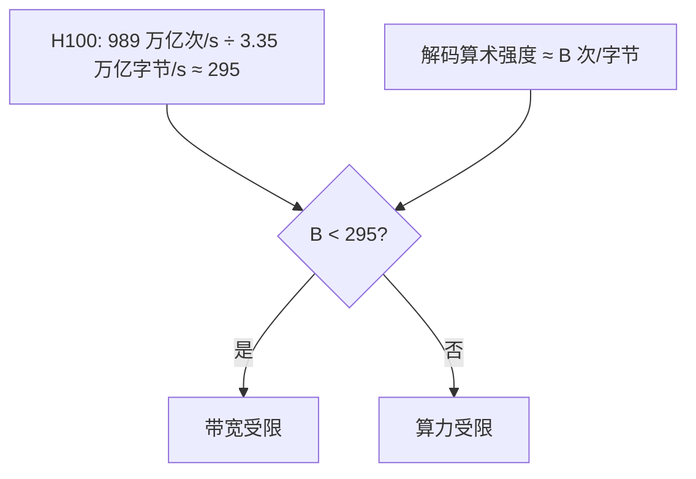

## Q
解码阶段批大小增加到多少时，会从"带宽受限"变成"算力受限"？用 H100 和 7B 模型算一下，并说明这个数字为什么在实际中更低或更高。

## A
**判断依据：** 一个计算是受带宽还是受算力限制，看"每读 1 字节数据做多少次运算"（算术强度，arithmetic intensity）和硬件的"算力 ÷ 带宽"比较：前者更小就是带宽受限。

**硬件比值：** H100 的 16 位矩阵乘法峰值约 989 万亿次/秒，显存（HBM，芯片旁的高带宽内存）带宽约 3.35 万亿字节/秒，比值约 **295 次/字节**。

**解码的算术强度：** 批大小为 B 时，每步读一遍权重（每个参数 2 字节），每个参数对 B 个 token 各做 1 次乘加（2 次运算）。
- 运算次数 ≈ 2 × 参数量 × B
- 读的字节 ≈ 2 × 参数量
- 算术强度 ≈ **B 次/字节**

**交叉点：** B ≈ 295 时两者相当。也就是说，纯看权重，H100 上的 16 位模型要凑到约 300 个请求一起解码，才把算力用满。

**实际中更低（更早变成算力受限）的原因：**
- 硬件很难跑到峰值算力，有效比值可能只有 150–200。
- 参数量化成 8 位后每参数 1 字节，同样的 B 下算术强度翻倍，交叉点减半。

**实际中更高（更难用满算力）的原因：**
- **KV 缓存也要读，而且不能共享：** 每个请求有自己的缓存，批大了缓存读取量同比例增加。注意力部分的算术强度始终很低，约为每字节 1 次左右。长上下文时，即使 B 很大，整体仍是带宽受限。
- **显存装不下那么多请求：** 7B 模型每 token 的 KV 缓存约 512 KB，300 个请求各 2,000 token 需要约 300 GB，一张 80 GB 的卡远远装不下。并发上限往往先被显存卡住。

**结论：** 对大多数实际部署，解码在可行的批大小下一直是带宽受限的。这就是为什么提高显存带宽、压缩权重和 KV 缓存、减少要读的字节，是加速解码的主要手段。

**新进展（2026 年 3 月）。** NVIDIA 在 GTC 上发布 Groq 3 LPX 机架：预填充留给 Rubin GPU，解码交给 Groq 的 LPU（每块约 500 MB 片上 SRAM）。按厂商标称的 FP8 算力 1.2 PFLOPS 和 150 TB/s 带宽算，LPU 的“算力÷带宽”只有约 8，本卡里 H100 是 295，所以解码在很小的批量下就把算力用满。

想一想：批量很小就够了，这类芯片为什么不是更省钱的选择？
每块只有 500 MB，大模型要很多块拼起来，NVIDIA 自己也说每块芯片的 token 速率不高。它卖的是单个用户的极高速度，每用户几百到上千 token/s，而不是每块芯片的吞吐。

