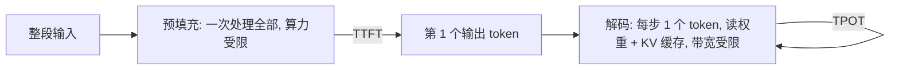

## Q
怎样用实验把一个推理服务的预填充（prefill）和解码（decode）两个阶段的性能分开测量？各自应该呈现什么规律，偏离规律说明什么？

## A
**两个阶段：** 预填充是一次性处理整段输入、算出第一个输出 token；解码是之后每步生成 1 个 token。token 是文字切成的小片段。预填充一次要做大量矩阵乘法，受**算力**限制；解码每步计算很少，却要把全部权重和这个请求的 KV 缓存（历史 token 每层的键、值向量）从显存读一遍，受**内存带宽**限制。

**实验一：扫输入长度，看首 token 延迟（TTFT）。**
- 单并发，`max_tokens=1`，输入长度取 128、512、2K、8K、32K。
- 预期：TTFT ≈ 固定开销 + 斜率 × 输入长度，长度很大时因为注意力的平方项而略微上翘。
- 斜率可换算成"每秒预填充多少 token"。7B 模型在 H100 上量级是每秒一万到几万 token。
- 偏离：短输入时 TTFT 就很高，说明固定开销大（分词、排队、调度）；斜率远低于理论值，说明预填充没有吃满算力。

**实验二：扫并发数，看每 token 间隔（TPOT）。**
- 固定输入 512、输出 512，并发取 1、2、4……256。
- 预期：小并发时 TPOT 几乎不变（多个请求共享一次读权重），总吞吐随并发近似线性增长；并发大到一定程度后 TPOT 开始明显上升，吞吐增长放缓。
- 并发为 1 时，TPOT 应接近"模型字节数 ÷ 显存带宽"的下限。7B（14 GB）在 H100（3.35 TB/s）上下限约 4.2 毫秒，实测 5–7 毫秒是合理的；实测 15 毫秒说明有大量额外开销。

**实验三：扫上下文长度，看 TPOT。**
- 并发固定，输入取 1K、8K、32K。上下文越长，每步要读的 KV 缓存越多，TPOT 线性上升。

**工具：** `vllm bench serve --random-input-len 2048 --random-output-len 1 --max-concurrency 1` 测 TTFT；把输出长度调大、扫 `--max-concurrency` 测 TPOT。结果和理论下限对比，比和另一个系统对比更能说明问题出在哪。
