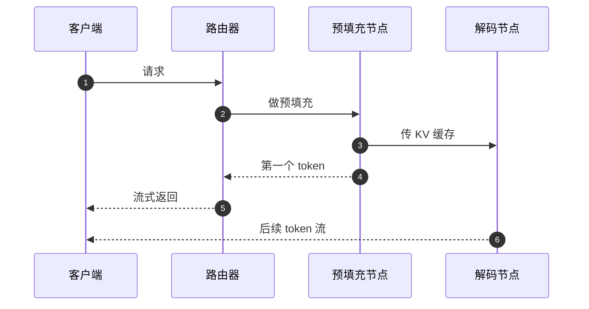

## Q
预填充与解码分离部署（prefill-decode disaggregation）时，一个请求的完整流程是什么？KV 缓存是怎样从预填充机器传到解码机器的？

## A
**两个阶段：** 预填充一次性处理整段输入，算出每个输入 token 每层的键、值向量（KV 缓存）和第一个输出 token，受算力限制；解码之后每步生成 1 个 token，读全部权重和 KV 缓存，受内存带宽限制。分离部署就是让两个阶段在不同的机器池上运行。

**步骤：**
1. **路由器选机器：** 按负载挑一个预填充节点和一个解码节点（也可以按前缀缓存命中情况挑）。
2. **预填充：** 预填充节点算完整段输入，得到 KV 缓存和第一个 token。
3. **传输 KV 缓存：** 直接从预填充节点的显存写到解码节点的显存，通常走 RDMA（远程直接内存访问：网卡直接读写对方内存，不经过 CPU 和操作系统内核），机内可走 NVLink。vLLM 通过 `--kv-transfer-config` 指定连接器，例如基于 NIXL 传输库的 `NixlConnector`。
4. **解码：** 解码节点把这个请求加入它的连续批处理，逐个生成后续 token，直接流式返回。
5. **释放：** 传完后预填充节点释放缓存；请求结束后解码节点释放。

**传输量估算：** Llama 3.1 70B 每 token 的 KV 缓存约 320 KB，4,000 token 的输入约 1.3 GB。在 400 Gb/s（约 50 GB/s）的 RDMA 网卡上约 26 毫秒。这段时间加进了首 token 之后的第二个 token 延迟里。可以按层边算边传，把传输和计算重叠。

**布局要匹配：** 两边的缓存块大小、数据类型、并行切分方式不同时，传输前要做重排，这是分离部署特有的复杂性和缺陷来源。
