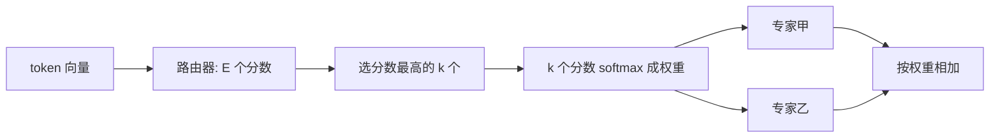

## Q
混合专家模型（MoE，mixture of experts）是怎样工作的？什么是路由器（router）和 top-k？用 Mixtral 8x7B 的数字说明"总参数"和"激活参数"的区别。

## A
**普通（稠密）模型：** 每层有一个前馈网络（先变宽、激活、再变窄的两次矩阵乘法），每个 token 都要经过它，用到全部参数。

**混合专家模型：** 把每层的前馈网络换成 E 个并列的前馈网络，称为"专家"（expert），外加一个很小的**路由器**。
1. 路由器是一个 `[隐藏宽度, E]` 的小矩阵。token 的向量乘它，得到 E 个分数。
2. 选分数最高的 k 个专家（**top-k**）。
3. 这 k 个分数经 softmax 变成权重（加起来为 1）。
4. token 只送进这 k 个专家计算，结果按权重相加。其余专家对这个 token 完全不计算。

注意力部分通常不变，所有 token 共用。

**Mixtral 8x7B 的数字：** 每层 8 个专家，top-2。
- **总参数约 467 亿：** 8 个专家的前馈网络加上共享的注意力等部分。不是 8 × 7 = 56B，因为注意力和嵌入只有一份。
- **激活参数约 129 亿：** 每个 token 实际用到的参数（2 个专家 + 共享部分）。

**这意味着：**
- **显存按总参数算：** 467 亿 × 2 字节 ≈ 93 GB，每个 token 都可能被路由到任何专家，所以全部专家都要在显存里。
- **每 token 计算量按激活参数算：** 约 2 × 129 亿 ≈ 260 亿次运算，和一个 13B 稠密模型相当。
- **"用 13B 的速度获得接近 47B 的能力"** 是混合专家的卖点。

**更大的例子：** DeepSeek-V3 总参数 6,710 亿，每 token 激活约 370 亿，每层 256 个路由专家选 8 个，另加 1 个所有 token 都会经过的共享专家。gpt-oss-120b 总参数约 1,170 亿，激活约 51 亿。

**推理时的微妙之处：** 批里不同 token 去不同专家，批越大，被用到的专家越多。小批量时每步只读少数专家，读的字节少；大批量时几乎所有专家都被读到，每步读取量接近总参数。
