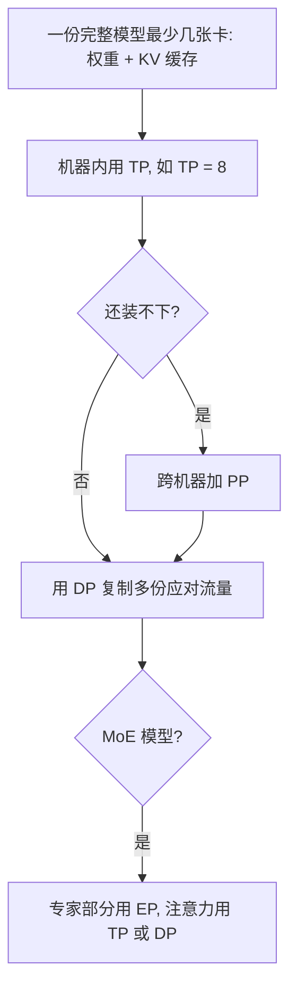

## Q
数据并行、张量并行、流水线并行、专家并行、序列（上下文）并行各切的是什么？推理服务里分别在什么情况下使用？

## A
| 方式 | 切的是什么 | 通信 | 推理里何时用 |
|---|---|---|---|
| **数据并行（DP）** | 不切模型，复制多个完整副本，请求分到不同副本 | 推理时几乎没有 | 模型能放进一组卡时，扩容的默认方式 |
| **张量并行（TP）** | 每层的矩阵切成 N 份 | 每层 2 次全体求和，量大、频繁 | 一台机器内，降低单请求延迟、放下大模型 |
| **流水线并行（PP）** | 按层切成几段 | 段与段之间只传激活值 | 模型大到跨机器；或互联较慢时 |
| **专家并行（EP）** | 混合专家模型的不同专家放在不同卡 | 每层两次"全体对全体"交换 token | 混合专家（MoE）模型，专家很多时 |
| **序列 / 上下文并行（SP / CP）** | 一个超长输入的 token 切到多张卡 | 注意力需要交换各段的键、值向量 | 几十万 token 的长上下文预填充 |

**名词：**
- **全体求和（all-reduce）：** 每张卡各有一份部分结果，通信后每张卡都拿到所有部分加起来的总和。
- **全体对全体（all-to-all）：** 每张卡都给其他每张卡发一份不同的数据，用于把 token 送到它要去的专家所在的卡。
- **混合专家（MoE）：** 每层有很多组前馈网络（专家），每个 token 只用其中几组。
- **激活值：** 每层计算产生的中间结果。

**组合的经验：**
- 先问"一份完整模型最少要几张卡"：权重加上足够的 KV 缓存（每个请求历史 token 的键、值向量）。
- 机器内用 TP（如 TP = 8），模型还装不下就跨机器加 PP。
- 再用 DP 复制多份应对流量。
- MoE 模型的专家部分用 EP，注意力部分仍可用 TP 或 DP。

**和训练的区别：** 训练的数据并行每步要同步梯度，通信很重；推理的数据并行副本之间互不通信，只需要前面的负载均衡器分配请求。
