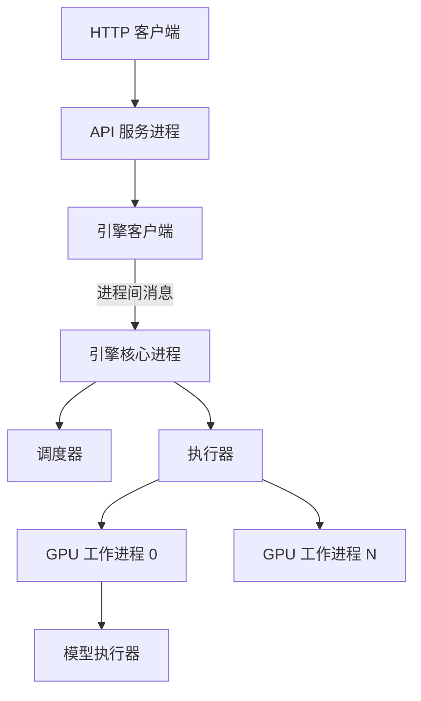

## Q
一个推理引擎（以 vLLM 为例）内部由哪些组件组成？一个请求从 HTTP 进入到在 GPU 上计算，经过哪些进程和模块？

## A
**推理引擎：** 把"一个模型 + 一堆加速卡"包装成能同时服务大量请求的服务程序。vLLM 新架构（V1）大致分成以下几层：

- **API 服务进程：** 基于 FastAPI 的 HTTP 服务，提供 OpenAI 兼容的 `/v1/chat/completions` 等接口。负责参数校验、套对话模板（把消息列表拼成模型训练时见过的文本格式）、分词（文字转 token 编号），以及把生成的 token 反分词成文字并通过 SSE 流式返回。
- **引擎核心进程：** 和 API 进程分开，通过 ZeroMQ 消息队列通信。这样分词等 CPU 工作不会抢占调度循环。它跑一个"忙循环"：每一步调用调度器，再让执行器执行。
- **调度器（scheduler）：** 每一步决定哪些请求参与本步计算、每个请求本步处理多少 token（在 token 预算内），为它们分配或回收 KV 缓存块（KV 缓存：每个请求历史 token 每层的键、值向量），显存不够时抢占某些请求。
- **执行器（executor）和工作进程（worker）：** 每张 GPU 一个工作进程。多卡张量并行时，执行器把同一步的任务广播给所有工作进程。
- **模型执行器（model runner）：** 把本步所有请求的 token 拼成一个输入张量，准备位置编号和缓存块表，调用模型做前向计算，再对每个请求做采样（从概率中选出下一个 token）。

**为什么要这样分层：** 加速卡很快，CPU 侧的任何拖延都会让它空等。把 HTTP 和分词放到独立进程、把每步的准备工作做得尽量少，是引擎性能的关键。

**排查时的含义：** 吞吐上不去时，先看是哪一层的问题：API 进程 CPU 打满（分词、JSON 序列化），还是调度循环慢，还是 GPU 计算本身慢。`py-spy dump --pid <进程号>` 可以分别查看各进程正在做什么。
