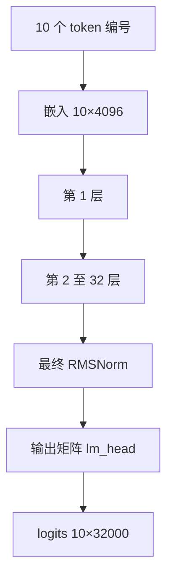

## Q
以 7B 模型（Llama 2 7B 结构）处理一个 10 个 token 的输入为例，按顺序走一遍完整的前向计算（forward pass），写出每一步的张量形状。

## A
前向计算就是把输入从第一层算到最后一层得到输出。token 是文字切成的小片段，每个有一个整数编号。结构参数：32 层，隐藏宽度 4,096，32 个注意力头（每头 128 维），前馈中间宽度 11,008，词表 32,000。

**每一层内部（形状都以 10 个 token 计）：**
1. **RMSNorm：** 把每个 token 的向量缩放到稳定大小，形状不变 `[10, 4096]`。
2. **算 Q、K、V：** 分别乘三个 `[4096, 4096]` 矩阵，各得 `[10, 4096]`，再拆成 32 个头 `[32, 10, 128]`。Q（查询）是"我在找什么"，K（键）是"我是什么"，V（值）是"我能提供什么"。
3. **旋转位置编码（RoPE）：** 按每个 token 的位置旋转 Q 和 K，让模型知道先后顺序。
4. **注意力：** 每个头算 `softmax(Q Kᵀ / √128)`，得 `[32, 10, 10]` 的权重，后面的位置被掩掉（只能看前面）；再乘 V 得 `[32, 10, 128]`，拼回 `[10, 4096]`。
5. **输出投影 + 残差：** 乘 `[4096, 4096]`，加回第 1 步之前的输入。
6. **RMSNorm → 前馈网络（SwiGLU）：** 两个 `[4096, 11008]` 矩阵变宽到 `[10, 11008]`，一个过 SiLU 激活后与另一个逐元素相乘，再乘 `[11008, 4096]` 变回 `[10, 4096]`，加回残差。

**最后：** 32 层之后再做一次 RMSNorm，乘输出矩阵 `[4096, 32000]`，得到 logits（模型给词表里每个 token 的原始分数）`[10, 32000]`。生成时只取最后一个位置的那 32,000 个分数去选下一个 token。

在 Hugging Face 里看真实形状：`model(ids, output_hidden_states=True).hidden_states` 返回 33 个 `[1, 10, 4096]`（嵌入输出加 32 层输出）。
