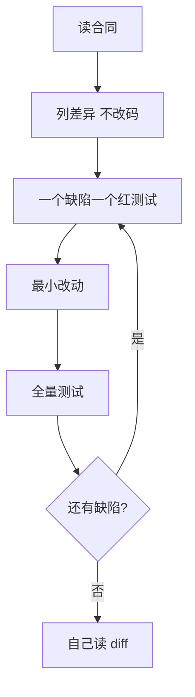

## Q
接到一个有多处缺陷的服务，怎么和智能体拆工作？每一小步的“完成”由什么判定？

## A
**先出计划，每一步用一个可运行的检查收口**

- **先读后写**：第一步只读合同、列差异，不改代码；它的计划和你的清单对不上，先纠正再动手；
- **一个缺陷一个红测试**：先有一个会失败的测试，再让它做最小改动；
- **每步收口**：改完立刻跑全量测试，通过再进下一个缺陷；
- **最后自己读 diff**：绿色的测试不能替你确认改动范围；
- **不并行**：互相依赖的改动不要同时开，回头对账成本高。

延伸

时间只够一半时，砍的是扩展和打磨，不砍“每个缺陷一个红测试”：没有红测试的修复，既不知道修没修好，也防不住回归。

**知识点：**拆成可验证的小步（Decomposition）
