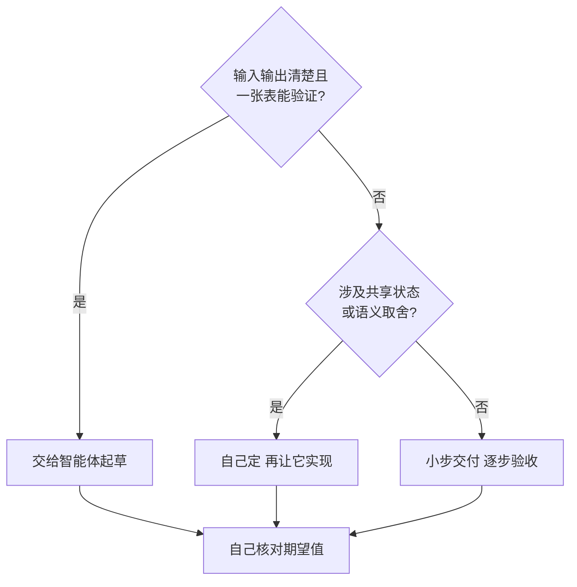

## Q
一个项目里有几十件事要做，哪些交给智能体起草，哪些必须自己决定？按什么标准分？

## A
**按“出错的代价”和“能否快速验证”分**

- **交出去**：输入输出清楚、一张表就能验证的部分，例如校验函数、规则表、解析器、测试夹具和 SQL 草稿；
- **自己定**：共享状态与锁的范围、检查顺序、边界归属、取整与平局规则、哪些东西不留痕；这些决定一旦错了，测试往往发现不了；
- **自己写**：期望值，和并发测试里的交错设计；
- **判断题**：这个分工是经验判断，不是定律；每次想“交不交”，问两件事：错了我多久能发现？错了代价多大？

**知识点：**该交给 AI 还是自己写（When to Delegate）
