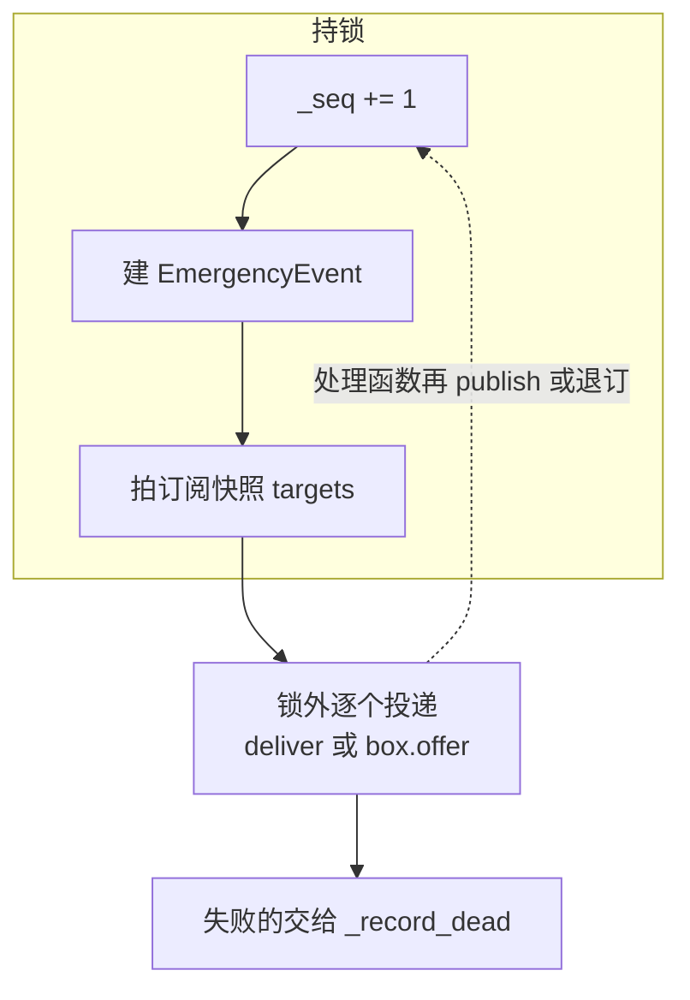

## Q
在应急发布订阅里，`publish` 的核心流程是什么？用 Python 写出来（订阅者出错不能影响别人，处理函数里可能再调 `publish`）。

## A
处理函数（handler）是订阅者登记的回调函数。持锁时只做编号和拍订阅快照，处理函数放到锁外调用：
```python
def publish(self, topic, severity, message, location=""):
    with self._lock:
        self._seq += 1
        event = EmergencyEvent(self._seq, topic, severity,
                               message, location, self._clock())
        targets = [(s, box) for s, box in self._subs.items()
                   if s.accepts(event)]
    for sub, box in targets:
        dead = sub.deliver(event) if box is None else box.offer(event)
        if dead is not None:
            self._record_dead(dead)
    return event
```



锁外调用才允许处理函数再发布或退订而不死锁。
