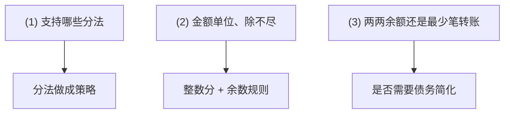

## Q
分账（Splitwise）要你设计什么？开场先问哪三个澄清问题？

## A
分账记录「谁垫了钱、谁该分担多少」，随时能回答「A 和 B 之间谁欠谁多少」。三问：(1) 支持哪些分法（均分、指定金额、按百分比）——决定分法做成策略；(2) 金额用什么单位、除不尽怎么办（100 分三人分）——决定用整数分和余数规则；(3) 只要两两余额，还是要「最少笔转账结清」——决定是否需要债务简化。

