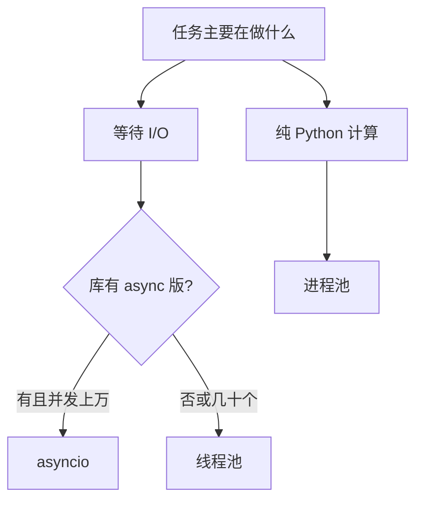

## Q
LLD 面试里给你一个“并发处理一批任务”的场景，怎样在 30 秒内选出线程池、协程还是进程池，并说清理由？

## A
**先问任务把时间花在哪里，再问并发量**

- **下载 200 个文件、调几十个下游**：线程池，阻塞库直接用，并发量就是池的大小；
- **上万个长连接的网关、WebSocket**：`asyncio`，每个连接只是一个协程；
- **批量缩放图片、解析大文件的纯 Python 逻辑**：进程池，分块提交；
- **工具或插件带超时，还不能信任**：线程不能被强杀，只能协作式取消；要硬超时就放进子进程，超时 `terminate()`；
- **说“默认线程池”之前先说明前提**：任务在等 I/O，或者主要时间在释放 GIL 的 C 库里；
- **混用时**：边界上只传可 pickle 的值和不可变的结果，共享可变状态的代码留在同一个线程或同一个进程里。

延伸

free-threaded 构建（3.14t）上线程池也能并行跑纯 Python 计算，选择会变：线程够用，不用付进程的拷贝和启动代价。但依赖的 C 扩展必须支持无 GIL，选型前要查。

**知识点：**线程、进程与协程的选择（Choosing a Model）
