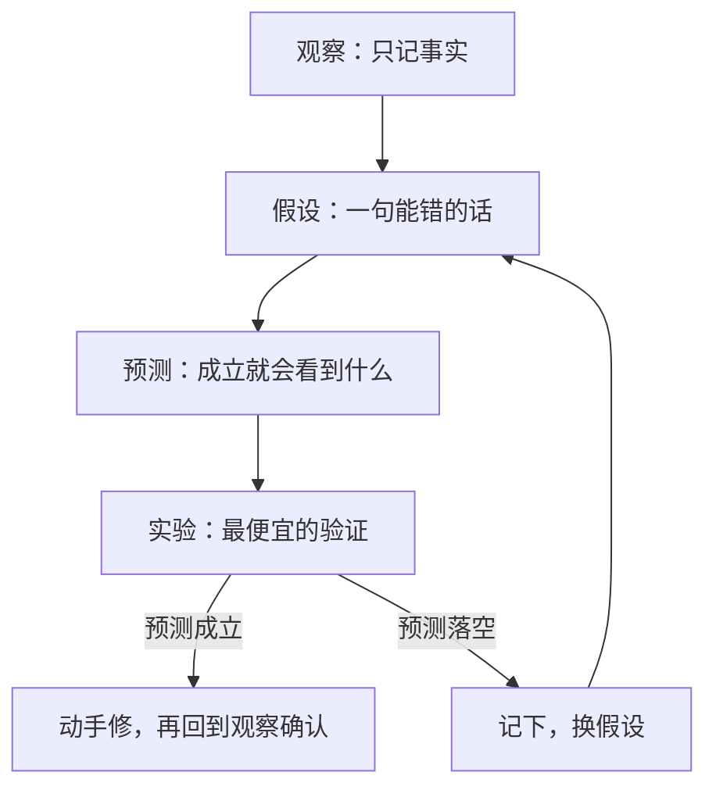

## Q
工单只写了“有人被重复扣款”。看到这条，是直接去翻代码找原因，还是先做别的？一个“好的假设”和“随便猜一下”差在哪？

## A
**先把症状翻成假设，再设计一个能证伪它的实验**

- **观察**：只写事实（谁、什么时候、几次、日志里有什么），不夹带原因；
- **假设**：一句能错的话，比如“客户端超时后重试，而扣款接口不是幂等的”；
- **预测**：如果假设成立，就应该看到什么，没看到就是假设错了（“每一对重复扣款之间，日志里都有一次超时”）；
- **实验**：用最便宜的办法看预测是否成立，通常是查日志或数据，不是改代码；
- **一次一个假设**：证实了才动手修；被推翻了，把这条线索记下，换下一个；
- **“随便猜”的假设没有预测**：什么结果都能圆回来的说法（“可能是并发问题”）没法被实验推翻，也就没法推进。

**知识点：**假设驱动（Hypothesis-Driven）
