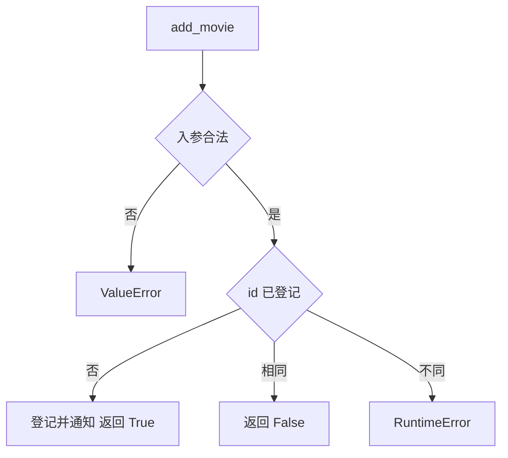

## Q
CastWatch 的用户关注演员，登记新片（`add_movie`）时要给关注者发通知，用 `inbox(user)` 读取。现有服务通知丢失、取关无效、重试导入返回值混乱、收件箱顺序不对，多个线程会同时调用。开工前你会先定下哪几条规则？

## A
**先把合同写成六条带数据的断言，再改代码。**

- **受众**：关注了卡司任一演员的用户，每人一条；关注两位主演、卡司里有重复 id 都只一条；空卡司没人收到
- **重复与冲突**：同 id、同片名、卡司集合相等，返回 `False` 且不通知，哪怕关注者变了；同 id 内容不同，抛 `movie_conflict` 且状态不变
- **关注与取关**：关注不回填；取关只删这一条关系、不删历史；重复关注与取关不存在的关系都是无操作
- **收件箱**：按登记顺序而不是 id 排序；返回副本，之后的导入不影响已拿到的结果
- **校验在先**：非法输入抛 `invalid_input`，发生在改状态之前，也先于冲突检查
- **并发**：任意并发调用等价于某个串行顺序，失败不留半截状态



```python
def add_movie(self, movie_id, title, actors):
    _valid(movie_id)
    _valid(title)
    if not isinstance(actors, list):
        raise ValueError(INVALID_INPUT)
    cast = frozenset(_valid(a) for a in list(actors))
    movie = _Movie(title, cast)
    with self._lock:
        if not self._catalog.is_new(movie_id, movie):
            return False              # 冲突在 is_new 里抛出
        audience = self._subscriptions.audience(cast)
        self._catalog.add(movie_id, movie)
        self._inboxes.deliver(audience, Notice(movie_id, title))
        return True
```

<details class="pt"><summary>延伸</summary>

每条规则配一个带具体数据的测试：卡司 `[a1, a2, a1]`、alice 关注 a1 与 a2，收件箱恰好一条；这些例子也是交给编程智能体的第一批断言。

</details>

**知识点：** 观察者与事件（Observer）、非法转移与幂等（Illegal Transitions）、边界校验（Validate at the Boundary）
