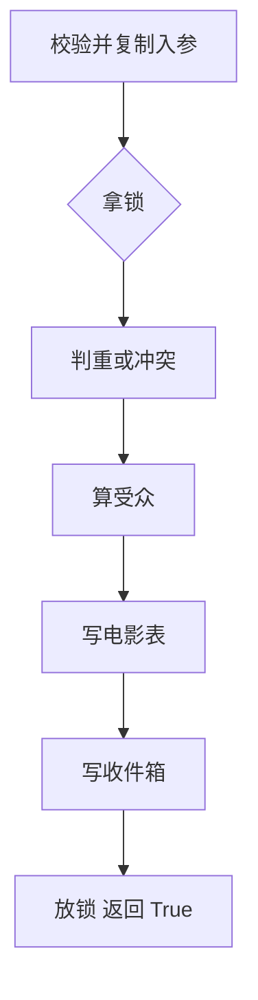

## Q
CastWatch 的 `add_movie` 要保存电影、再给关注者生成通知，同时别的线程在导入、关注、取关。哪几步必须一起成功或一起失败，哪些可以放在这个范围之外？

## A
**判重、算受众、写电影、写收件箱同在一把锁里；校验放锁外。**

- **同一个临界区**：判重与冲突、读关注者算受众、写电影表、写收件箱，由同一把锁罩住
- **其他方法拿同一把锁**：`follow`、`unfollow`、`inbox` 同锁，受众就是登记那一刻的关注者，结果等价于某个串行顺序
- **先算后写**：冲突检查和受众计算都在任何写入之前，之后的写入不会失败，电影和通知要么都在要么都不在，不需要回滚
- **校验放锁外**：非法输入进不了临界区，不会留下半截状态
- **登记表、收件箱各一把锁、分两步写的后果**：重复导入已返回 `False`，通知却还没进收件箱



```python
with self._lock:
    if not self._catalog.is_new(movie_id, movie):
        return False               # 相同导入：不动任何状态
    # 到这里不会再失败：先算出受众，再一并提交
    audience = self._subscriptions.audience(cast)
    self._catalog.add(movie_id, movie)
    self._inboxes.deliver(audience, Notice(movie_id, title))
    return True
```

<details class="pt"><summary>延伸</summary>

一把锁让所有操作串行，临界区随受众大小增长；换成数据库时，把「判重、算受众、写入」放进同一个事务。`threading.Lock` 管不到别的进程。

</details>

**知识点：** 复合操作（Compound Actions）、线程安全结构的写法（Thread-Safe Structures）、同步原语（threading）
