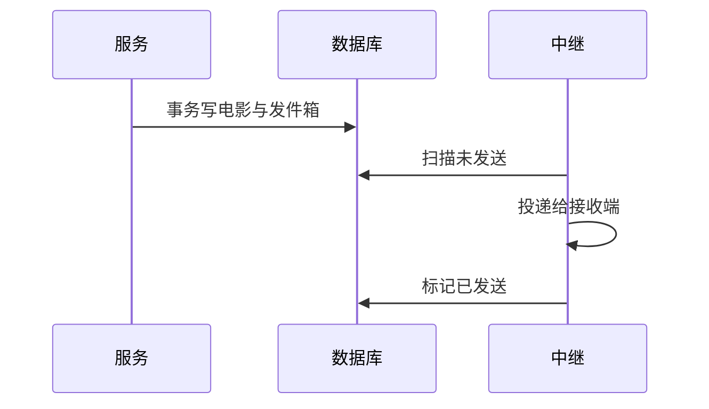

## Q
CastWatch 的通知要改成持久、可靠的投递（先写数据库，再推送给用户）。引入事务发件箱（transactional outbox）之后，崩溃恢复怎么做，才能让通知既不丢也不重复？

## A
**同事务写电影与发件箱，至少一次投递，接收端去重。**

- **问题**：先存电影再发通知，两步之间崩溃，电影在而通知永远丢了
- **发件箱**：电影行与发件箱行（受众也在这个事务里读出）一起提交，要么都在要么都回滚
- **恢复**：重启后，中继进程扫描未发送的行，投递后标记已发送
- **至少一次**：崩溃发生在「投递之后、标记之前」，重启后会重发
- **去重**：接收端以（用户，电影 id）为唯一键，效果上恰好一次
- **幂等入口**：同 id 的重复导入仍在事务里判成无操作，内容不同抛冲突



```python
with db:                              # 一个事务
    row = db.execute("SELECT title FROM movie WHERE id = ?", (mid,)).fetchone()
    if row and row[0] != title:       # 卡司同理比较
        raise RuntimeError("movie_conflict")   # 回滚，什么都不写
    if row is None:                   # 重复导入：什么都不写
        db.execute("INSERT INTO movie VALUES (?, ?)", (mid, title))
        db.executemany("INSERT INTO outbox(user, movie) VALUES (?, ?)",
                       [(u, mid) for u in audience])

for user, mid in db.execute("SELECT user, movie FROM outbox WHERE sent = 0").fetchall():
    db.execute("INSERT OR IGNORE INTO inbox VALUES (?, ?)", (user, mid))  # 接收端去重
    db.execute("UPDATE outbox SET sent = 1 WHERE user = ? AND movie = ?", (user, mid))
```

<details class="pt"><summary>延伸</summary>

中继可以多实例并行，靠唯一键兜住重复；发件箱表要定期清理已发送的行。

</details>

**知识点：** 重试与退避（Retry & Backoff）、非法转移与幂等（Illegal Transitions）、观察者与事件（Observer）
