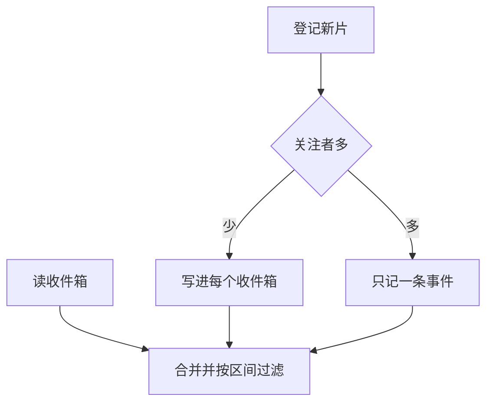

## Q
CastWatch 里一位演员有一千万关注者。登记他的新片时，现在的做法会出什么问题？你怎么改，哪些规则必须保住？

## A
**大 V 改读扩散，读收件箱时按关注区间合并。**

- **问题**：持锁往一千万个收件箱各追加一条，持锁时间随关注者数增长，所有操作被挡住，内存也多一千万份
- **推拉结合**：关注者少的演员照旧写扩散；超大演员只记一条发布事件，读时合并
- **必须保住的规则**：关注之前的不回填，取关之后的不收，已收到的历史不删，所以每人记关注区间（关注与取关时的登记序号）
- **另一条路**：登记只写事件，后台分批投递，以（用户，电影 id）为幂等键
- **代价**：读路径要合并两路并按登记顺序排序，通知可能晚到



```python
def inbox(user):
    pulled = [(seq, m) for seq, m in events          # 大 V 的发布事件
              if any(lo <= seq < hi for lo, hi in spans.get(user, []))]
    return [m for _, m in sorted(own.get(user, []) + pulled)]
```

<details class="pt"><summary>延伸</summary>

登记与记录事件仍是一个原子步骤；区间表随取关增长，要定期折叠，读多写少的演员才值得读扩散。

</details>

**知识点：** 观察者与事件（Observer）、并行加速与锁竞争（Parallel Speedup & Contention）、按访问模式选结构（Choosing Structures）
