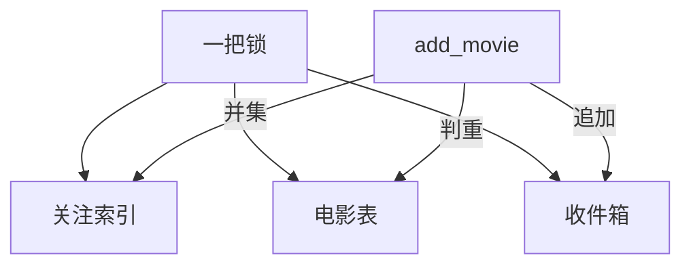

## Q
在 CastWatch 的关注与通知服务里，你要存哪些状态？每一块用什么结构？哪条不变量最要紧，什么写法会把它破坏？

## A
**三块状态；最要紧的不变量：每部片对登记时刻的受众恰好一条。**

- **关注索引**：`dict[演员, set[用户]]`，登记时对卡司求并集，不扫全部用户，并集天然去重
- **电影表**：`dict[id, 冻结记录]`，记录是（片名，卡司集合），相等比较就是「重复还是冲突」
- **收件箱**：`dict[用户, list[Notice]]`，只追加；`Notice` 冻结，读取返回新列表
- **不变量的守法**：电影表与收件箱的写入不可分，同在一把锁里，先算后写
- **清理**：集合清空就删，索引大小只与现存关注关系成正比
- **破坏方式**：存调用方的列表引用、返回内部列表、两块状态各用一把锁、读路径上用 `setdefault`



```python
@dataclass(frozen=True)
class Notice:
    movie_id: str
    title: str

@dataclass(frozen=True)
class _Movie:
    title: str
    cast: frozenset[str]

def __init__(self):
    self._followers: dict[str, set[str]] = {}
    self._movies: dict[str, _Movie] = {}
    self._notices: dict[str, list[Notice]] = {}
```

<details class="pt"><summary>延伸</summary>

收件箱只追加，所以列表下标是稳定的游标：已读与分页只需给每个用户加一个只增不减的水位，`Notice` 保持不可变，另两块状态一行不动。

</details>

**知识点：** 防御性拷贝（Defensive Copying）、复合操作（Compound Actions）、按访问模式选结构（Choosing Structures）
