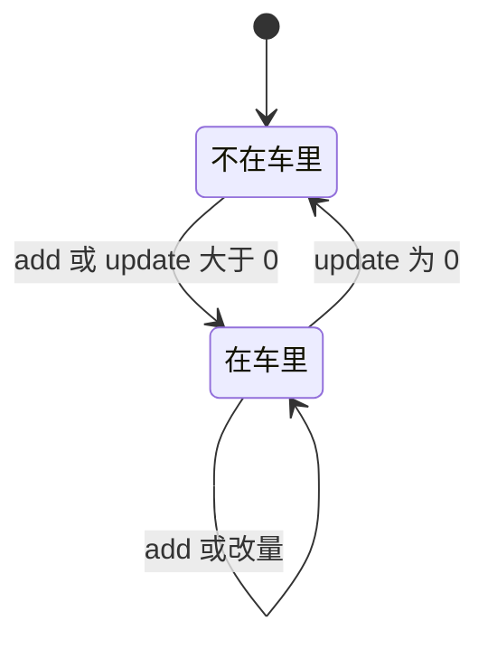

## Q
你要给服装店的网页写购物车组件（ShoppingCart）：目录已经给定，组件只管加一件、把数量改成指定值，以及返回目录与购物车的快照。动手之前，你会先定下哪几条规则，让隐藏测试没有可钻的空子？

## A
**行序、改量、合计、独立四件事，每件都写成一条可测的规则**

- **行序**：新出现的行追加在末尾；已有的行加一或改量都不挪位置；删除后再加回来落在末尾
- **改量是绝对值**：0 到 1,000,000；正数可以新建行；0 删除这一行，行不存在时什么都不做
- **两个有序视图**：`products` 永远按目录原序、每项带 `cartQuantity`；`items` 按插入序、每项带 `lineTotalCents`
- **合计精确**：`lineTotalCents = 单价 × 数量`，总数是各行之和，全是整数；空车总数为 0，`empty` 当且仅当没有行
- **身份只看 id**：名字或价格相同也是两个商品；目录在构造时拷贝
- **快照独立**：之后的调用不改旧快照，改快照不影响购物车，两辆车互不共享



```python
def updateLine(self, productId, quantity):
    self._catalogue.get(productId)        # 先确认商品存在
    if quantity == 0:
        self._quantity.pop(productId, None)   # 缺席时什么都不做
    else:
        self._quantity[productId] = quantity  # 已有的键不挪位置，新键在末尾
```

<details class="pt"><summary>延伸</summary>规则写成测试时，把"加 p1、加 p2、删 p1、再加 p1"这个序列放在第一个：它一次钉住新行在末尾、删除、重加落末尾三条；改量与加一要各写一遍，因为它们是两个入口。</details>

**知识点：** 规格与契约（Specifications）、值对象与不可变性（Value Objects）、用例选择（Partitioning & Boundaries）
