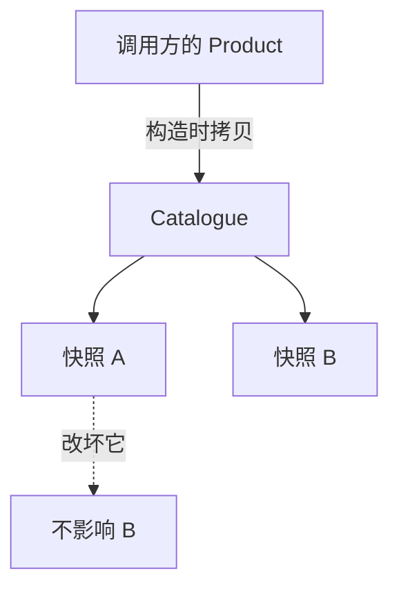

## Q
服装店购物车组件（ShoppingCart）的调用方在构造后改了自己的商品对象并清空了列表；页面把拿到的快照里的列表清空、商品改名；测试还用同一批商品对象开了两辆购物车。你怎么保证这三条通道都碰不到购物车内部，又怎么证明自己做到了？

## A
**输入拷进来、输出新建出去、状态不共享，各配一个改了再看的测试**

- **输入通道**：构造时把商品拷成冻结条目；之后调用方改名、改价、清空列表，购物车都读不到
- **输出通道**：每次 `snapshot()` 新建全部对象和列表；不缓存上一次的快照，也不把内部字典或条目交出去
- **实例通道**：状态只在实例上，不放在类属性或模块变量里，两辆车才互不影响
- **验证输入**：构造后改商品、清空列表，再看快照的名字和价格没变
- **验证输出**：拿一个旧快照留着，之后再调用若干次，深比较旧快照没变；对另一个快照清空列表、改字段，下一个快照仍然正确
- **验证实例**：两辆车共用同一批商品对象，在一辆上操作，另一辆保持为空



```python
def test_isolation():
    products = [Product("p1", "Hat", 100)]
    cart = ShoppingCart(products)
    products[0].name = "x"; products.clear()      # 改输入
    cart.addLine("p1")
    held, expected = cart.snapshot(), asdict(cart.snapshot())
    cart.addLine("p1")                            # 之后的调用
    victim = cart.snapshot()
    victim.items.clear(); victim.products[0].name = "y"   # 改输出
    assert asdict(held) == expected               # 旧快照不变
    assert cart.snapshot().items[0].quantity == 2  # 内部没被改坏
```

<details class="pt"><summary>延伸</summary>再加一道随机对拍：用最朴素的列表模型跑一万次随机操作，隔几步比较，旧快照一并比较。不可变快照（冻结数据类加元组）能把"改输出"这条通道在类型上堵死，代价是调用方想要可改的副本时要自己拷；多线程读写同一辆车时，快照要在同一把锁里构造，才不会读到半个更新。</details>

**知识点：** 防御性拷贝（Defensive Copying）、可变性与别名（Mutability & Aliasing）、验证输出（Verification）
