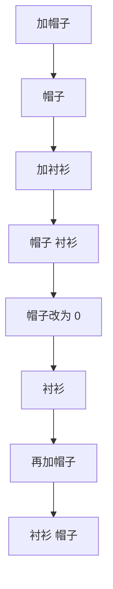

## Q
顾客先把帽子加进购物车，再加衬衫；随后把帽子减到 0，又点了一次"加入购物车"。服装店购物车组件（ShoppingCart）里，帽子应该排在哪里？你怎么保证它总是这样排，而不是碰巧对？

## A
**行序就是字典的插入序：删掉再加，自然落在最后**

- **应有的顺序**：加帽子、加衬衫得 `[帽子, 衬衫]`；帽子减到 0 得 `[衬衫]`；再加帽子得 `[衬衫, 帽子]`
- **关键在"删除"是真删除**：数量为 0 的行不入库；若把数量写成 0 留着，再加回来时帽子还占着旧位置
- **已有行不挪位置**：给已有的键重新赋值，字典保持它原来的位置，所以加一和改量都不动顺序
- **别从目录推顺序**：按目录顺序重建行，帽子会回到衬衫前面；`products` 才按目录序，`items` 按插入序
- **用例要成序列**：断言加帽、加衬衫、删帽、加帽后 `items` 的 ID 顺序是 `["衬衫", "帽子"]`，目录顺序不变



```python
d = {}
d["hat"] = 1; d["shirt"] = 1; d["hat"] = 3   # 改量：位置不变
print(list(d))                                # ['hat', 'shirt']
del d["hat"]; d["hat"] = 1                    # 删除后再加
print(list(d))                                # ['shirt', 'hat']
```

<details class="pt"><summary>延伸</summary>要在大量行里删除并保持顺序时，字典（Python 3.7 起保证插入序）仍是 O(1)；换成列表要 O(行数) 地找和删。要把顺序存进数据库，就加一个单调递增的序号列，删除后再加回来得到一个新序号。</details>

**知识点：** 容器的选择与惯用法（Collections Idioms）、不变量与封装（Invariants）、预测输出与副作用（Predicting Behaviour）
