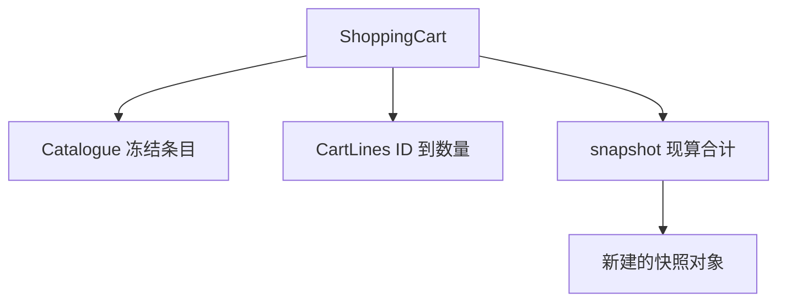

## Q
服装店购物车组件（ShoppingCart）要在内存里记住目录和购物车的行，每次快照还要给出各行小计和总价。你会存哪些状态，哪条不变量最要紧？

## A
**只存冻结的目录和"ID → 数量"的有序字典，合计每次现算**

- **目录**：构造时把调用方的商品拷成冻结条目（ID、名字、单价），保持原序、按 ID 查；之后不再引用调用方的对象
- **行**：一个字典，键是商品 ID，值是数量；字典的插入序就是行序，不另存顺序列表
- **最要紧的不变量**：字典里只有 1 到 1,000,000 的数量，0 从不入库；"删除"就是 `pop`，不是写 0
- **合计不另存**：小计、总数量、总价都从行现算，数据只有一份，不会出现总数与行对不上
- **失败先于修改**：未知 ID、越界或非整数的数量在写入之前抛错，购物车原样不动



```python
class CartLines:
    def __init__(self):
        self._quantity: dict[str, int] = {}   # 不变量：值都在 1..1_000_000

    def set(self, product_id, quantity):
        if type(quantity) is not int or not 0 <= quantity <= MAX_QUANTITY:
            raise QuantityError(product_id, quantity)   # 先校验，后修改
        if quantity == 0:
            self._quantity.pop(product_id, None)
        else:
            self._quantity[product_id] = quantity
```

<details class="pt"><summary>延伸</summary>行数至多 100，现算合计是 O(行数)，比维护一个"总价"字段更不容易出错；行数上万、查询极多时才值得增量维护，并且要和现算的结果对拍。</details>

**知识点：** 不变量与封装（Invariants）、容器的选择与惯用法（Collections Idioms）、内存持久化（In-Memory Persistence）
