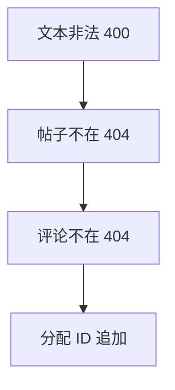

## Q
你要给一个讨论平台的评论服务（Comments & Replies）写实现：帖子下有评论，评论下有回复，只有这两层；数据放在内存里，被很多请求线程同时调用。动手写代码之前，你会先定下哪几条规则？

## A
**先定检查顺序，再定 ID、顺序、返回值三件事**

- **检查顺序固定**：文本 → 帖子 → 评论；同时出错时先到先赢，所以顺序本身就是合同
- **文本只在判空时 `strip`**：必须是 `str` 且去空白后非空；存下来、返回的都是原值
- **"找不到"只有一种**：评论存在但属于别的帖子，也是 `NotFoundError`
- **两条独立的 ID 序列**：评论一条、回复一条，失败的调用不烧号；本实现全站递增，README 没说按帖子分
- **顺序就是提交顺序**：不按 `created_at` 排；后提交的 ID 更大
- **返回快照**：每次新建字典与列表，调用方怎么改都伤不到内部



```python
def add_reply(self, post_id, comment_id, user_id, content):
    _require_text(user_id, "user_id")      # 1. 先看参数
    _require_text(content, "content")
    self._require_post(post_id)            # 2. 再查帖子
    with self._lock:
        thread = self._threads.get(post_id)
        comment = thread.find(comment_id) if thread is not None else None
        if comment is None:                # 3. 评论必须在这个帖子下
            raise NotFoundError(...)
        reply = Reply(next(self._reply_ids), ...)   # 4. 全过了才取号
```

<details class="pt"><summary>延伸</summary>换成数据库时，"评论属于这个帖子"变成带外键的约束或 `WHERE id=? AND post_id=?`，查不到就是 `NotFoundError`；检查顺序依旧要写进测试。</details>

**知识点：** 边界校验（Validate at the Boundary）、接口的错误契约（Error Contract）、规格与契约（Specifications）
