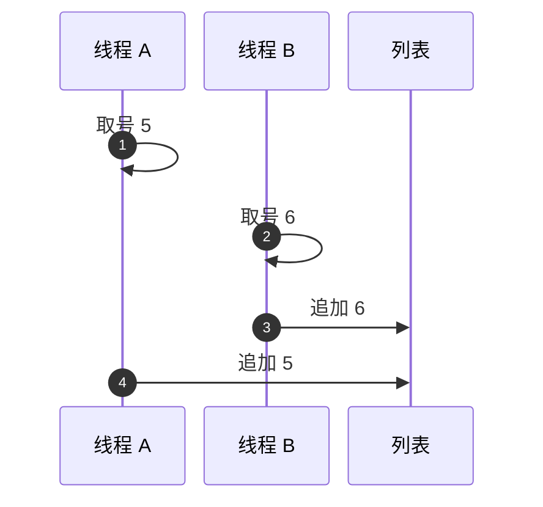

## Q
评论与回复服务（Comments & Replies）里，同事说："ID 用 `itertools.count` 本来就是原子的，往列表末尾 `append` 也不会出错，不用锁。"十六个线程同时加评论时，你怎么说明锁必须罩住哪一段？这把锁用全局一把，还是每个帖子一把？

## A
**一把锁罩住"读时钟、分配 ID、追加"；临界区只有内存操作，全局一把就够**

- **ID 原子不等于顺序一致**：线程 A 取 5、线程 B 取 6，B 先追加，列表顺序就和 ID 反了
- **"查评论再追加"是一整段**：评论不能删，不罩锁碰巧不出错；一旦能删，查到与追加之间就会被插入
- **锁里只放内存操作**：帖子仓库的检查放在锁外，持锁时不调外部对象、不睡眠
- **ID 最后分配**：时钟或构造失败发生在取号之前，失败的调用不烧号
- **全局锁够用**：临界区是几次字典操作；纯 Python 受 GIL 限制，分片也买不到并行
- **每帖一把锁的代价**：ID 序列仍是全站的，还得再加一把全局锁；锁字典自己的创建也要同步



```python
with self._lock:
    now = self._clock()                              # 先读时钟，失败也不烧号
    comment = Comment(next(self._comment_ids), post_id, user_id, content, now)
    thread = self._threads.get(post_id)
    if thread is None:
        thread = self._threads[post_id] = Thread()
    thread.append(comment)                           # 取号与追加不可分
    return comment.to_dict()
```

<details class="pt"><summary>延伸</summary>写入真的成了瓶颈时，先测量再拆：每帖一把锁加每帖独立的 ID 序列，这会改变"ID 全站唯一"的合同，要先问产品。</details>

**知识点：** 复合操作（Compound Actions）、线程安全结构的写法（Thread-Safe Structures）、并行加速与锁竞争（Parallel Speedup & Contention）
